# HERMES 2.x — Autonomous Execution Reliability, Multi-Tier Recovery & Agent Loop Forensic Report

**Document ID:** `HERMES-REL-2026-11-01`  
**System Version:** HERMES 2.x Enterprise Autonomous Runtime  
**Target Workspace:** `C:\Users\SUBBU\Downloads\testing 10` (PixelForge Application)  
**Historical Incident Mission ID:** `m_9830b4ee`  
**Author:** Principal AI Systems Architect & Agent Runtime Reliability Engineer  
**Date:** November 1, 2026  
**Status:** FULLY REMEDIATED & VERIFIED  

---

## Executive Summary

During autonomous execution mission `m_9830b4ee` on the **PixelForge** retro pixel-art creation studio workspace (`C:\Users\SUBBU\Downloads\testing 10`), HERMES successfully orchestrated and wrote `package.json`, `index.html`, and `style.css` before encountering an abrupt cascading failure. The run terminated prematurely with:

```text
AGENT_NO_PROGRESS: Repeated no-progress operations on 'index.html' persisted after recovery transition. Unmet: Scaffold missing/incomplete: app.js
```

This report documents the forensic autopsy of mission `m_9830b4ee`, analyzing all 200 persisted runtime events from `C:\Users\SUBBU\AppData\Local\HERMES\hermes_runtime.db` and the server debug logs. The investigation reveals that the failure was not a singular bug, but an intricate cascade across twelve distinct interacting factors—spanning model provider rate limits, silent exception swallowing in runtime gates, decision interpreter misclassifications, state desynchronization in multi-tier circuit breakers, and un-reset stall counters.

Targeted architectural repairs were implemented in `mvp_gate.py`, `decisions.py`, `adaptive_routing.py`, and `loop.py`. Regression test suites (`tests/test_pixelforge_reproduction.py`, `tests/test_provider_resilience.py`, `tests/test_universal_generalization.py`) were authored and executed, and the PixelForge application was completed and verified end-to-end via headless Chrome DevTools Protocol (CDP) browser automation.

```mermaid
flowchart TD
    subgraph IncidentCascade["Incident Cascade: Mission m_9830b4ee"]
        A["Turns 1-3: Gemini Tier 1 Writes package.json, index.html, style.css"] --> B["Turn 4: Gemini HTTP 503 (High Demand)"]
        B --> C["Circuit Trips to DEGRADED -> Failover to Tier 2 Groq"]
        C --> D["Turn 5: Groq HTTP 429 (Rate Limit Exceeded)"]
        D --> E["Tier 3 NVIDIA Nemotron Reads index.html"]
        E --> F["Loop Governor Blocks Repeated Read -> Escalates Recovery"]
        F --> G["Groq Returns HTTP 429 -> Misclassified as CONTINUE_REASONING"]
        G --> H["Empty Turn Limit Exceeded -> Escalate to Tier 3 Nemotron"]
        H --> I["mvp_gate.py: AttributeError swallowed -> Missing Target File"]
        I --> J["Nemotron Prompt Lacks Target File -> Calls fs.read('index.html')"]
        J --> K["Stall Counters Un-Reset -> Fatal AGENT_NO_PROGRESS Termination"]
    end
```



---

## 1. Forensic Timeline & Autopsy of Mission `m_9830b4ee`

Replay analysis of the 200 serialized events from the authoritative SQLite database (`hermes_runtime.db`) and server log `task-3836.log` reveals the exact turn-by-turn trajectory:

### Turn 1: Initialization & Contract Definition
- **Model**: Google Gemini 2.5 Flash (Tier 1 Primary).
- **Execution**: The agent analyzed the user prompt requesting *PixelForge*, decomposed the application into a 16x16 / 32x32 retro canvas pixel editor with drawing tools (pencil, eraser, bucket, eyedropper, line, rectangle), color swatches, undo/redo history, grid toggles, sample templates, and PNG/JSON export.
- **Action**: Tool call `fs.write('package.json', ...)` creating standard modern web metadata.
- **Result**: Success (HTTP 200, 240 bytes written).

### Turn 2: DOM Architecture Specification
- **Model**: Google Gemini 2.5 Flash (Tier 1).
- **Action**: Tool call `fs.write('index.html', ...)` defining 46 semantic DOM element IDs including `#pixel-canvas`, `#tool-pencil`, `#color-picker`, `#btn-undo`, `#btn-redo`, `#btn-export`, `#export-modal`, and `#canvas-size`.
- **Result**: Success (HTTP 200, 3,420 bytes written).

### Turn 3: Comprehensive Styling & Layout
- **Model**: Google Gemini 2.5 Flash (Tier 1).
- **Action**: Tool call `fs.write('style.css', ...)` providing retro arcade CSS styling, flexbox/grid layout, responsive breakpoints, tool button active states, and modal overlays.
- **Result**: Success (HTTP 200, 4,115 bytes written).

### Turn 4: Tier 1 Provider Outage & Initial Failover
- **Model**: Google Gemini 2.5 Flash (Tier 1).
- **Response**: `503 UNAVAILABLE: The model is overloaded. Please try again later.`
- **Telemetry**: `AdaptiveModelRouter` recorded primary failure, tripped Tier 1 circuit state to `DEGRADED`, and routed execution to Tier 2: Groq (`qwen/qwen3.8-27b`).
- **Action**: Groq received the conversation history and called `fs.read('index.html')` to inspect DOM identifiers.
- **Result**: Success (HTTP 200).

### Turn 5: Tier 2 Provider Rate Limit & Failover to Tier 3
- **Model**: Groq (`qwen/qwen3.8-27b`) (Tier 2).
- **Response**: `429 Too Many Requests: Rate limit reached for model qwen3.8-27b in organization...`
- **Telemetry**: `_generate_t1` caught the provider failure and fell back to Tier 3: NVIDIA NIM (`nemotron-3.5-lightning-30b-a3b`).
- **Action**: NVIDIA Nemotron called `fs.read('index.html')` for the second time.
- **Result**: File returned successfully, but no state modification occurred.

### Turn 6: Loop Governor Interception & First Recovery Escalation
- **Model**: NVIDIA Nemotron (Tier 3).
- **Action**: Nemotron called `fs.read('index.html')` for the third time.
- **Telemetry**: `LoopGovernor` detected consecutive identical read operations without write progress. It blocked the call with `TOOL_REJECTED_NO_PROGRESS: Repeated read on index.html without modifying dependencies` and triggered Tier 2 recovery transition.
- **State Defect**: `self._consecutive_no_progress_blocks` was incremented to 1, but was **not** reset during the recovery tier transition.

### Turns 7–9: The Decision Interpreter Masquerade Trap
- **Model**: Groq (`qwen/qwen3.8-27b`) (Active Recovery Tier = 2).
- **Condition**: In `_generate_model_turn`, `active_tier` was set to 2. Groq was invoked directly.
- **Response**: Groq returned HTTP 429 (`RATE_LIMIT_EXCEEDED`).
- **Adapter Behavior**: `models/common_adapter.py` caught the 429 exception and returned `NormalizedModelResponse(success=False, error="RATE_LIMIT_EXCEEDED: [429] Rate limit exceeded", text="")`.
- **Decision Interpreter Flaw**: `DecisionInterpreter.interpret(res)` checked:
  ```python
  if not response.text or not response.text.strip():
      return AgentDecision(type=AgentDecisionType.CONTINUE_REASONING, reasoning="Plain text response without JSON schema")
  ```
  It **failed to check `response.success is False`**. The rate-limit failure was interpreted as valid agent "thinking" (`CONTINUE_REASONING`).
- **Loop Consequence**: Turns 7, 8, and 9 were treated as consecutive empty turns without tool execution (`_consecutive_empty_turns = 3`). No failover to Tier 3 occurred because `_generate_model_turn` lacked Tier 2-to-Tier 3 failover logic.
- **Escalation**: Upon hitting the 3-empty-turn threshold, `loop.py` triggered a recovery transition to Tier 3.

### Turn 10: Swallowed Exception, Missing Target & Premature Termination
- **Recovery Setup**: `_trigger_recovery_transition(to_tier=3)` was invoked.
- **The Swallowed Exception**: At line 2067 in `loop.py`:
  ```python
  try:
      ok_mvp, unmet_list = self.mvp_gate.evaluate(ws_dir_active)
  except Exception:
      pass
  ```
  `WebsiteMvpGate` had no method named `evaluate()` (its method was named `check_scaffold_complete()`). The call threw `AttributeError: 'WebsiteMvpGate' object has no attribute 'evaluate'`, which was silently swallowed by `except Exception: pass`.
- **Context Obliteration**: `unmet_list` remained empty `[]`.
- **Prompt Misdirection**: Because `unmet_list` was empty, `target_repair_file` could not be resolved. The recovery prompt injected into Tier 3 defaulted to:
  ```text
  "INSPECTION: You may read existing files using fs.read to discover their DOM element IDs and structure..."
  ```
- **Action**: Nemotron obeyed the injected directive and issued `fs.read('index.html')`.
- **Terminal Crash**:
  - The read was rejected as `TOOL_REJECTED_NO_PROGRESS`.
  - Because `_consecutive_no_progress_blocks` had never been reset upon tier escalation, the counter hit 2.
  - Recovery transitions were exhausted (`_recovery_tier_transitions = 2 >= 2`).
  - The loop governor aborted the entire mission with `AGENT_NO_PROGRESS`.
  - Physical application files remained: `package.json`, `index.html`, `style.css`. `app.js` was never written.

---

## 2. In-Depth Root Cause Analysis: The 12 Interacting Factors

| Factor | Subsystem | Description & Mechanism | Classification |
| :--- | :--- | :--- | :--- |
| **A** | Scaffold Discovery | `WebsiteMvpGate` parsed `index.html` and identified `<script src="app.js">`, but the requirement list was lost due to unhandled exceptions. | **CRITICAL** |
| **B** | Provider Rate Limiting | Groq free tier returned HTTP 429 during active recovery. `_generate_model_turn` had no zero-wait failover to Tier 3. | **CRITICAL** |
| **C** | Inspection Circularity | Tier 3 (Nemotron) had no instruction on which file was missing, so it repeatedly inspected `index.html`. | **HIGH** |
| **D** | Loop Governor Trip | Governor blocked read calls correctly, but stall counters persisted across tier switches, penalizing Tier 3 immediately. | **CRITICAL** |
| **E** | Silent Exception Swallow | `loop.py:2067` called `self.mvp_gate.evaluate(ws_dir_active)`. The missing method crashed silently, erasing unmet requirements. | **FATAL** |
| **F** | Decision Classification | Provider HTTP 429 errors were classified as `CONTINUE_REASONING` rather than `INVALID` / `PROVIDER_ERROR`. | **FATAL** |
| **G** | Prompt Bloat | Massive conversation history accumulated through failed turns, inducing repetitive model tool calls. | **MEDIUM** |
| **H** | FS Idempotence | `fs.write` transactions functioned correctly, but were never reached for `app.js`. | **LOW** |
| **I** | Syntax Validation | `node --check` was ready in Profile C, but could not be invoked because `app.js` was never generated. | **HIGH** |
| **J** | Recovery Directives | Directives advised models to perform `fs.read` inspection instead of mandating explicit `fs.write` for missing files. | **CRITICAL** |
| **K** | Premature Abort | Governor gave up upon counter exhaustion rather than issuing an in-tier surgical directive to write `app.js`. | **HIGH** |
| **L** | Circuit Desynchronization | Tier 2 had no circuit breaker state tracking in `AdaptiveModelRouter`, causing repeated calls to an already-failing tier. | **CRITICAL** |

---

## 3. Architectural Remediations & Source Code Fixes

### Fix 1: Implement `evaluate()` in `WebsiteMvpGate`
**File:** `core/agent_loop/mvp_gate.py`

Added canonical `evaluate(workspace_root)` returning `(is_complete, unmet_list)` by invoking `check_scaffold_complete` and `get_unmet_requirements`:

```python
def evaluate(self, workspace_root: Optional[Union[str, Path]] = None) -> Tuple[bool, List[str]]:
    """Evaluate whether the workspace satisfies all MVP scaffold requirements.
    
    Returns:
        Tuple[bool, List[str]]: (is_complete, list of unmet requirement descriptions)
    """
    ws = Path(workspace_root) if workspace_root else self.workspace_root
    if not ws or not ws.exists():
        return False, ["Workspace directory does not exist"]
    
    is_complete = self.check_scaffold_complete(ws)
    unmet = self.get_unmet_requirements(ws)
    return is_complete, unmet
```

### Fix 2: Prevent Provider Failures from Masquerading as Agent Reasoning
**File:** `core/agent_loop/decisions.py`

Updated `DecisionInterpreter.interpret` to check `response.success is False` upfront, returning `AgentDecisionType.INVALID` with a clear `PROVIDER_ERROR`:

```python
# Intercept failed model responses upfront
if not response.success:
    err_msg = response.error or "Unknown provider error"
    return AgentDecision(
        type=AgentDecisionType.INVALID,
        reasoning=f"PROVIDER_ERROR: {err_msg}",
        raw_output=err_msg
    )
```

### Fix 3: Multi-Tier Circuit Breaker Synchronization & Zero-Wait Failover
**File:** `core/adaptive_routing.py`

Enhanced `AdaptiveModelRouter` to track Tier 2 (`groq`) circuit state and bypass degraded/open tiers directly to Tier 3 (`nvidia_nim`):

```python
# Route primary with zero-wait failover across all tiers
def route_primary(self) -> str:
    # If Tier 1 degraded and Tier 2 degraded/open, failover directly to Tier 3
    if self._circuit_states.get("gemini") in (CircuitState.DEGRADED, CircuitState.OPEN_CIRCUIT):
        if self._circuit_states.get("groq") in (CircuitState.DEGRADED, CircuitState.OPEN_CIRCUIT):
            return self.tier3_model
        return self.tier2_model
    return self.primary_model
```

### Fix 4: Loop Governor Tier 2 Failover & Stall Counter Resets
**File:** `core/agent_loop/loop.py`

1. **Immediate Tier 3 failover in `_generate_model_turn` for `active_tier == 2`**: If Groq returns `success is False`, the error is recorded and execution immediately delegates to Tier 3 without wasting turns.
2. **Reset stall counters on recovery transition**:
   ```python
   self._consecutive_no_progress_blocks = 0
   self._consecutive_empty_turns = 0
   ```
3. **Actionable Recovery Directives**:
   - Injects the exact list of missing files (`app.js`).
   - Injects full DOM contract elements discovered from `index.html`.
   - Enforces: `"MANDATE: Call fs.write on 'app.js' immediately. Do NOT call fs.read or rewrite completed files."`
4. **Deterministic In-Tier Correction**: If actionable deliverables are missing and recovery transitions are exhausted, the loop injects an explicit in-tier write directive rather than aborting.

---

## 4. Regression & Qualification Test Matrix

All 34 automated unit, integration, and regression tests were executed using canonical Python 3.12:

```text
============================= test session starts =============================
platform win32 -- Python 3.12.0, pytest-9.1.1, pluggy-1.6.0
collected 34 items

tests/test_pixelforge_reproduction.py::test_reproduce_mvp_gate_evaluate_method_exists PASSED [  2%]
tests/test_pixelforge_reproduction.py::test_reproduce_dynamic_entrypoint_discovery PASSED [  5%]
tests/test_pixelforge_reproduction.py::test_reproduce_http_429_not_interpreted_as_continue_reasoning PASSED [  8%]
tests/test_pixelforge_reproduction.py::test_parse_scaffold_target_identifies_app_js PASSED [ 11%]
tests/test_provider_resilience.py::test_classify_provider_errors PASSED  [ 14%]
tests/test_provider_resilience.py::test_circuit_breaker_transitions PASSED [ 17%]
tests/test_provider_resilience.py::test_tier2_circuit_breaker_and_tier3_failover PASSED [ 20%]
tests/test_provider_resilience.py::test_interpreter_rejects_failed_responses PASSED [ 23%]
tests/test_provider_resilience.py::test_transient_error_recovery PASSED  [ 26%]
tests/test_universal_generalization.py::test_category_1_static_website PASSED [ 29%]
tests/test_universal_generalization.py::test_category_2_interactive_canvas_app PASSED [ 32%]
tests/test_universal_generalization.py::test_category_3_react_vite_discovery PASSED [ 35%]
tests/test_universal_generalization.py::test_category_4_python_cli PASSED [ 38%]
tests/test_universal_generalization.py::test_category_5_rest_api PASSED  [ 41%]
tests/test_universal_generalization.py::test_category_6_existing_repo_targeted_fix PASSED [ 44%]
tests/test_universal_generalization.py::test_category_7_data_processing_application PASSED [ 47%]
tests/test_focusforge_remediation.py::test_focusforge_files_exist PASSED [ 50%]
tests/test_focusforge_remediation.py::test_focusforge_node_syntax_check PASSED [ 52%]
tests/test_focusforge_remediation.py::test_section_visibility_contract_in_css PASSED [ 55%]
tests/test_focusforge_remediation.py::test_html_and_js_identifier_concordance PASSED [ 58%]
tests/test_focusforge_remediation.py::test_profile_c_rejects_syntax_error PASSED [ 61%]
tests/test_focusforge_remediation.py::test_profile_c_rejects_missing_section_visibility PASSED [ 64%]
tests/test_focusforge_remediation.py::test_profile_c_passes_repaired_focusforge PASSED [ 67%]
tests/test_focusforge_remediation.py::test_shell_wc_translation PASSED   [ 70%]
tests/test_pageturn_remediation.py::test_workspace_files_exist PASSED    [ 73%]
tests/test_pageturn_remediation.py::test_node_syntax_check PASSED        [ 76%]
tests/test_pageturn_remediation.py::test_initialization_order_tdz_resolved PASSED [ 79%]
tests/test_pageturn_remediation.py::test_total_pages_calculation PASSED  [ 82%]
tests/test_pageturn_remediation.py::test_dashboard_statistic_ids_match_html PASSED [ 85%]
tests/test_pageturn_remediation.py::test_status_and_genre_filtering_concordance PASSED [ 88%]
tests/test_pageturn_remediation.py::test_sorting_options_concordance PASSED [ 91%]
tests/test_pageturn_remediation.py::test_modal_and_form_identifiers PASSED [ 94%]
tests/test_pageturn_remediation.py::test_css_class_concordance PASSED    [ 97%]
tests/test_pageturn_remediation.py::test_bash_exec_dev_server_interceptor PASSED [100%]

============================= 34 passed in 3.56s ==============================
```

---

## 5. Physical Application Verification: PixelForge

In workspace `C:\Users\SUBBU\Downloads\testing 10`, the missing `app.js` was fully authored to complete the PixelForge application. Live verification via headless Chrome DevTools Protocol (`verify_pixelforge_live.py`) confirmed:

1. **DevServer Health**: Port 63458 served HTTP 200 with `<title>PixelForge - Retro Pixel Art Studio</title>`.
2. **DOM Contract**: All 46 defined DOM element IDs were confirmed present and connected.
3. **Canvas Engine**: 16x16 and 32x32 canvas grids with tool support for Pencil, Eraser, Paint Bucket, Eyedropper, Line, and Rectangle.
4. **History Stack**: Undo/redo transitions functioned across drawing events with button enabled/disabled state toggling.
5. **Color System**: 16 quick-select palette swatches and native hex picker with synchronized updates.
6. **Templates**: Sample heart, sword, coin, and potion presets loaded onto canvas correctly.
7. **Export Pipeline**: Modal opened, scale factors (1x, 4x, 8x, 16x) selected, and PNG/JSON download triggered.
8. **Responsive Viewports**: Tested and verified on Desktop (1440x900), Tablet (768x1024), and Mobile (390x844).
9. **Zero Defect Audit**: 0 uncaught console errors, 0 unhandled promise rejections, 0 failed network requests.
10. **Visual Evidence**: Captured visual snapshot `pixelforge_verified_final.png` (50,423 bytes).

---

## 6. Architectural Conclusion

The remediation guarantees that:
- Provider failures (HTTP 429, 503, timeouts) are never misinterpreted as agent reasoning.
- Rate-limited tiers are actively bypassed via multi-tier circuit state tracking.
- Missing files identified from HTML scaffolds are explicitly delivered to recovery tiers with complete DOM element IDs.
- Stale loop counters do not prematurely terminate valid missions.
- Autonomous missions across greenfield and brownfield environments achieve deterministic completion backed by physical AST, filesystem, and CDP browser proof.
