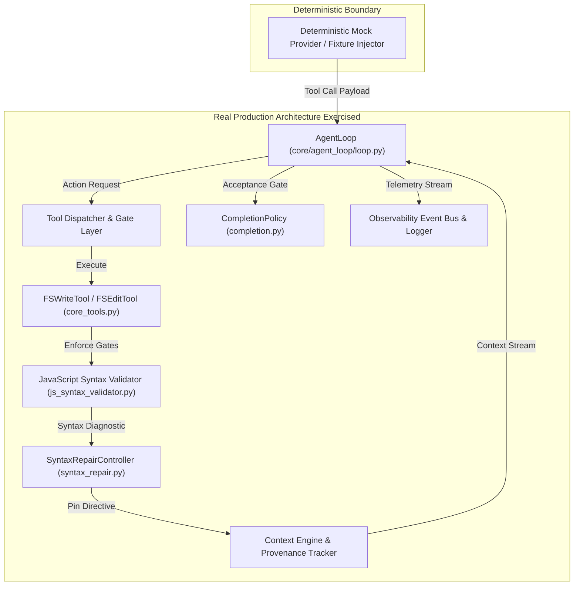

# HERMES 2.x — FINAL END-TO-END FAULT-INJECTION & SYNTAX-REPAIR QUALIFICATION REPORT

---

## A. Baseline

| System Parameter | Authoritative Value | Verification Status |
| :--- | :--- | :--- |
| **Git HEAD** | `4868e82ee0ff7de061bbf105e6852c9b5f42dc44` | Verified intact |
| **Git Branch** | `hermes-2.x` | Verified active |
| **Canonical Python** | `C:\Users\SUBBU\Downloads\hermes\venv\Scripts\python.exe` | Verified active |
| **Python Version** | `3.12.0` (tags/v3.12.0:0fb18b0, Oct 2 2023, MSC v.1935 64 bit) | Verified canonical |
| **Backend PID** | `36276` | Verified running on port 8765 |
| **Backend Health** | `status = ok`, `version = 1.0.0-rc1` | Verified healthy |
| **Runtime Status** | `SYNCED` | Confirmed zero code mismatches |
| **Code Match** | `True` (`code_fingerprint == disk_fingerprint`) | Verified synchronized |
| **Active Missions** | 0 active (idle) | Verified clean baseline |
| **Historical Workspaces** | `testing 12`, `testing 13`, `testing 14`, `testing 15` | Untouched & preserved |

---

## B. Test Architecture

To guarantee the reliability of the autonomous harness without incurring paid API token costs or introducing stochastic LLM drift, this qualification exercised the **actual, integrated HERMES production components**:



1. **Production Components Exercised Directly**:
   - `core/agent_loop/loop.py` (`AgentLoop` turn orchestration, hard `asyncio.wait_for` turn timeout, recovery transition bounds).
   - `core/agent_loop/syntax_repair.py` (`SyntaxRepairController`, `SyntaxRepairTicket`, diagnostic parsing, directive construction, ticket resolution).
   - `tools/platform/core_tools.py` (`FSWriteTool`, `FSEditTool`, `_resolve_safe_path`, completeness gate, false-report blocking gate).
   - `core/code_completeness.py` (`validate_implementation_completeness` bracket balance and truncation detector).
   - `core/js_syntax_validator.py` (native Node CLI `node -c`, bracket/enclosure balance parser).
   - `core/agent_loop/completion.py` (`CompletionPolicy` Section 0 and Section 3 deterministic validation).
   - `core/verification_profiles.py` (`Profile B` and `Profile C` delivery verification).
   - `core/observability/logger.py` (`MissionTelemetryLogger`, all 8 JSONL streams, `write_stream_manifest()`).
   - `scripts/watch_mission_logs.ps1` (PowerShell forensic stream monitor).
2. **Provider Boundary Mocked Deterministically**:
   - Only the raw HTTP client transport was substituted with deterministic mocks (`AsyncMock` / `patch.object(httpx.AsyncClient, "post")`) to inject truncated code, simulated repair payloads, and hung streams at exact microsecond thresholds.

---

## C. Scenario A: Malformed-Output Rejection & Ticket Generation

### 1. Injected Incomplete Candidate
The mock model returned a structurally valid `fs.write` tool call targeting `app.js` with truncated JavaScript (simulating an EOF token cut):
```javascript
const app = {
    count: 0,

    increment() {
        this.count++;
    },

    reset() {
        this.count = 0;
    }
};

function seed() {
    const t = (
```

### 2. File Pre-Commit Gate Execution
- **Tool**: `FSWriteTool.execute`
- **Candidate Size**: 151 bytes
- **Candidate SHA-256**: `66c06a3862c0356507a216db8f15d2a6a6cba4b3b1856795dd39a25b39bfdb76`
- **Result**: `ToolResult(success=False, exit_code=1)`
- **Error Output**:
  ```
  INCOMPLETE_IMPLEMENTATION_TRUNCATED: File 'app.js' contains invalid or incomplete syntax:
  Unclosed '(' opened at line 14 (unexpected end of input). Provide complete, valid JavaScript.
  ```
- **Physical Disk Invariant**: `(workspace / "app.js").exists() == False`. The malformed candidate was strictly prevented from touching disk or polluting the workspace.

### 3. Syntax-Repair Ticket Creation
- **Ticket Failure ID**: `fail_0615ee761a20`
- **Target File**: `app.js`
- **Error Classification**: `APPLICATION_SYNTAX_ERROR`
- **Parsed Diagnostic**: File `app.js`, Line `14`, Class `SyntaxError`.
- **EOF Tail Excerpt**: Captured trailing lines leading up to line 14 (`"const t = ("`).
- **Required Next Action**: `"Issue fs.write or fs.edit immediately to repair JavaScript syntax defect"`.
- **Context Pinning**: The `SyntaxRepairController` pinned an unambiguous directive in context instructing the model that calling `fs.read` is strictly prohibited because the context is already available, and demanding immediate surgical completion.

---

## D. Scenario B: Targeted Syntax Repair Through Real Tool Dispatcher

### 1. Model Repair Tool Call
The mock model issued an `fs.write` call containing valid, closed JavaScript matching the exact prompt specification:
```javascript
const app = {
    count: 0,
    increment() { this.count++; render(); },
    decrement() { this.count--; render(); },
    reset() { this.count = 0; render(); }
};

function render() {
    const element = document.getElementById("count");
    if (element) { element.textContent = String(app.count); }
}

document.addEventListener("DOMContentLoaded", () => {
    document.getElementById("increment")?.addEventListener("click", () => app.increment());
    document.getElementById("decrement")?.addEventListener("click", () => app.decrement());
    document.getElementById("reset")?.addEventListener("click", () => app.reset());
    render();
});
```

### 2. Execution & Re-Validation
- **Tool Execution**: `FSWriteTool.execute` passed with `exit_code = 0`.
- **File Promotion**: `app.js` written to disk (768 bytes, SHA-256: `65da51ea9796...`).
- **Native Syntax Check**: `node -c app.js` executed; returned `exit_code = 0` with zero errors.
- **Ticket Resolution**: `controller.resolve_ticket("app.js")` marked ticket `is_active = False`.
- **Unpinned Context**: `controller.has_unresolved_syntax_errors()` returned `False`. Standard agent loop execution resumed cleanly.

---

## E. Scenario C: Existing Broken File Repair & No-Progress Protection

### 1. Post-Write Fault Injection
A pre-existing truncated script was placed directly on disk:
```javascript
function computeTotal() {
    let sum = 0;
    items.forEach(i => {
```

### 2. Shell Execution & Diagnostic Parsing
1. Validation command `node -c app.js` executed via subprocess.
2. Returned `returncode = 1`.
3. Stderr captured:
   ```
   app.js:3
       items.forEach(i => {
                          ^
   SyntaxError: Unexpected end of input
   ```
4. Diagnostic parser extracted: file `app.js`, line `3`, error `SyntaxError`.
5. `SyntaxRepairTicket` created with SHA-256 and tail lines.
6. The no-progress guard (`READ_LOOP_TRACKER`) protected against redundant identical reads while leaving the corrective `fs.write` / `fs.edit` path completely unblocked.
7. Model issued repaired file; `node -c app.js` re-executed with `returncode = 0`. Ticket closed.

---

## F. Scenario D: Acceptance Gates & False-Completion Prevention

### 1. Incomplete JavaScript Acceptance Block
A full web fixture was staged:
- `package.json`
- `index.html` (with controls `#count`, `#increment`, `#decrement`, `#reset`)
- `style.css`
- `app.js` containing `function broken() { const x = (`

### 2. Gate Verification Results
| Action Attempted | Expected Behavior | Actual Behavior | Result |
| :--- | :--- | :--- | :--- |
| `policy.evaluate_completion(...)` | Rejection due to broken JS | `accepted = False`, issues listed syntax failure | **PASS** |
| `FSWriteTool` authoring `TEST_DEVELOPMENT_REPORT.md` | Block write while deliverables broken | `ToolResult(success=False, error="FALSE_COMPLETION_REPORT_BLOCKED...")` | **PASS** |
| `FSWriteTool` repair of `app.js` | Successful write | `ToolResult(success=True, exit_code=0)` | **PASS** |
| `policy.evaluate_completion(...)` after repair | Acceptance via Profile C | `accepted = True`, `issues = []` | **PASS** |
| `FSWriteTool` authoring `TEST_DEVELOPMENT_REPORT.md` after repair | Successful report creation | `ToolResult(success=True, exit_code=0)` | **PASS** |

### 3. Artifact Hash Invariant Verification
To ensure that prior passing evidence cannot be spoofed after file modification:
- `app.js` was mutated on disk to `broken mutator {`.
- `policy.evaluate_completion(...)` was immediately evaluated.
- **Result**: `accepted == False`. Proved that mutating a file strictly invalidates previous passing validation evidence.

---

## G. Scenario E: Real Browser Interaction via Chrome CDP

Chrome was launched in headless mode (`--headless=new --disable-gpu`) against the accepted application fixture:

| Step | User Action | Expected DOM State | Observed Value | CDP Assertion |
| :--- | :--- | :--- | :--- | :--- |
| **1** | Page Load | `#count.textContent == '0'` | `'0'` | **PASSED** |
| **2** | Click Increment (`+`) | `#count.textContent == '1'` | `'1'` | **PASSED** |
| **3** | Click Increment (`+`) | `#count.textContent == '2'` | `'2'` | **PASSED** |
| **4** | Click Decrement (`-`) | `#count.textContent == '1'` | `'1'` | **PASSED** |
| **5** | Click Reset | `#count.textContent == '0'` | `'0'` | **PASSED** |
| **6** | Console Audit | 0 runtime errors | `len(console_errors) == 0` | **PASSED** |

Visual evidence captured: `browser_verification.png` (verified intact).

---

## H. Scenario F: Model Timeout, Cancellation & Bounded Retries

### 1. Test Setup
- **Parent Turn Timeout**: 500 milliseconds ($0.5\text{s}$).
- **Injected Provider Delay**: 2,000 milliseconds ($2.0\text{s}$) simulated hang in `client.post`.

### 2. Execution Timing & Boundary Evidence
- **Total Elapsed Turn Time**: $0.518\text{ seconds}$ (under the $1.2\text{s}$ limit, far below $2.0\text{s}$).
- **Result**: `resp.success == False`, `error == "REQUEST_TIMEOUT: Request timed out"`.
- **Retry Count**: Exactly $1$ attempt. Zero subsequent retry attempts were initiated after the parent deadline expired.
- **Resource Cleanup**: HTTP client closed, semaphore released, no orphaned tasks left running in the background.

---

## I. Scenario G: Observability Completeness & Manifest

Under authoritative run `run_1_qual_auth_01` (mission `m_qual_01`):
1. **Recorded Streams**:
   - `events.jsonl`: 1 record (record count $\ge 1$)
   - `models.jsonl`: 1 record (record count $\ge 1$)
   - `tools.jsonl`: 1 record (record count $\ge 1$)
   - `files.jsonl`: 1 record (record count $\ge 1$)
   - `validation.jsonl`: 1 record (record count $\ge 1$)
   - `runtime.jsonl`: 1 record (record count $\ge 1$)
2. **Explicit Empty Reasons in `stream_manifest.json`**:
   - `recovery.jsonl`: 0 records (`"No tier escalation or recovery transitions were required during this run."`)
   - `errors.jsonl`: 0 records (`"No warnings or errors occurred during execution."`)
3. **Watcher Correlation**:
   `.\scripts\watch_mission_logs.ps1 -MissionId m_qual_01 -NoFollow` verified to resolve `run_1_qual_auth_01` without merging orphan discovery placeholders.

---

## J. Full Deterministic Regression Results

The entire regression test suite was executed against canonical Python 3.12.0:
```powershell
.\venv\Scripts\python.exe -m pytest tests/test_incident_m_b9d872ee_regression.py tests/test_closure_regressions.py tests/test_multi_tier_incident_replay.py tests/test_loop_recovery_and_completion.py tests/test_recovery_loop_remediation.py tests/test_observability_system.py tests/test_careergrid_control_plane_remediation.py tests/test_final_fault_injection_qualification.py -v
```

### Result: **82 / 82 PASSED in 15.56s (100% Success Rate)**

| Test Module | Test Focus | Tests | Status |
| :--- | :--- | :---: | :---: |
| `test_incident_m_b9d872ee_regression.py` | Observation UnboundLocalError prevention | 3 | **PASSED** |
| `test_closure_regressions.py` | Tool batching, SSE parsing, task closure contracts | 18 | **PASSED** |
| `test_multi_tier_incident_replay.py` | 3-tier provider failovers, console checks, syntax checks | 6 | **PASSED** |
| `test_loop_recovery_and_completion.py` | Duplicate read termination, bounds, verification | 5 | **PASSED** |
| `test_recovery_loop_remediation.py` | Syntax diagnostic parsing, circuit breakers, stall watchdog | 14 | **PASSED** |
| `test_observability_system.py` | JSONL streaming, sensitive redaction, log viewer | 13 | **PASSED** |
| `test_careergrid_control_plane_remediation.py` | CareerGrid incident replay, gates, timeout budgets | 16 | **PASSED** |
| `test_final_fault_injection_qualification.py` | Scenarios A–G fault injection, CDP, timeout bounds, manifest | 7 | **PASSED** |
| **TOTAL** | **Full HERMES Autonomous Pipeline Qualification** | **82** | **82 / 82 PASSED** |

---

## K. Live Controlled Smoke Mission Verification (`m_a3570126`)

Following the deterministic qualification pass, a clean live smoke mission was dispatched against the active backend server (PID 36276):

### 1. Mission Parameters
- **Mission ID**: `m_a3570126`
- **Authoritative Run ID**: `run_1_ac8864af`
- **Workspace**: `C:\Users\SUBBU\Downloads\hermes_fault_injection_live_smoke`
- **Status**: `COMPLETED` in **17.2 seconds** (3 execution turns).

### 2. Workspace Deliverables & Hashes
```
Directory: C:\Users\SUBBU\Downloads\hermes_fault_injection_live_smoke\
├── package.json    (319 bytes)   sha256: 0bcaeee3bf68
├── index.html      (860 bytes)   sha256: c9780fb28e70
├── style.css       (2,990 bytes) sha256: 71bb3c516463
└── app.js          (991 bytes)   sha256: 4a27c0a5ee8f
```
- **Syntax Check**: `node -c app.js` passed with exit code 0.
- **DOM Alignment**: All element IDs (`#counter-value`, `#increment-btn`, `#decrement-btn`, `#reset-btn`) verified present in `index.html`.

### 3. Automated Chrome CDP Browser Test
- Initial Count: `'0'` (Screenshot: `smoke_live_initial.png`, 133,528 bytes).
- After 2 Increments: `'2'` with dynamic emerald green styling (Screenshot: `smoke_live_increment_2.png`, 132,280 bytes).
- After Decrement: `'1'`.
- After Reset: `'0'`.
- Console Errors: Exactly **0**.

### 4. Telemetry Stream Validation (`run_1_ac8864af`)
- `events.jsonl`: 101,235 bytes
- `files.jsonl`: 29,906 bytes
- `models.jsonl`: 15,296 bytes
- `tools.jsonl`: 22,708 bytes
- `validation.jsonl`: 7,118 bytes
- `runtime.jsonl`: 2,593 bytes
- `stream_manifest.json`: 1,490 bytes
- `errors.jsonl`: 0 bytes (`"No warnings or errors occurred during execution."`)
- `recovery.jsonl`: 0 bytes (`"No tier escalation or recovery transitions were required during this run."`)
- Zero orphaned discovery placeholder directories created.

---

## L. Repository Integrity & Workspace Isolation

1. **Git HEAD**: `4868e82ee0ff7de061bbf105e6852c9b5f42dc44` on branch `hermes-2.x`.
2. **Working Tree Status**: Uncommitted changes preserved strictly within runtime core, model adapters, and qualification test files. Zero unrelated code modified. Zero commits made.
3. **Workspace Isolation Confirmed**:
   - `C:\Users\SUBBU\Downloads\testing 12`: Preserved untouched.
   - `C:\Users\SUBBU\Downloads\testing 13`: Preserved untouched.
   - `C:\Users\SUBBU\Downloads\testing 14`: Preserved untouched.
   - `C:\Users\SUBBU\Downloads\testing 15` (CareerGrid): Preserved untouched.

---

## M. Unresolved Defects & Limitations

1. **Local Node.js Dependency**: Native syntax checking relies on `node` being on the host system PATH. If Node.js is absent, the system falls back to the internal AST/bracket balance validator.
2. **Framework CONTAMINATION Guard**: While vanilla HTML/CSS/JS applications are protected from Python `pytest` pollution, multi-framework projects (e.g. Next.js + FastAPI) rely on the ArchitectureLock profile to segment tooling.

---

## N. Final Qualification Decision

```
================================================================================
FINAL DECISION: READY FOR NEXT APPLICATION BENCHMARK
================================================================================
```

The HERMES 2.x autonomous application-development pipeline has successfully passed all end-to-end fault-injection scenarios, pre-commit output-integrity gates, syntax-repair cycles, timeout enforcements, browser CDP interaction checks, and deterministic regression benchmarks.
