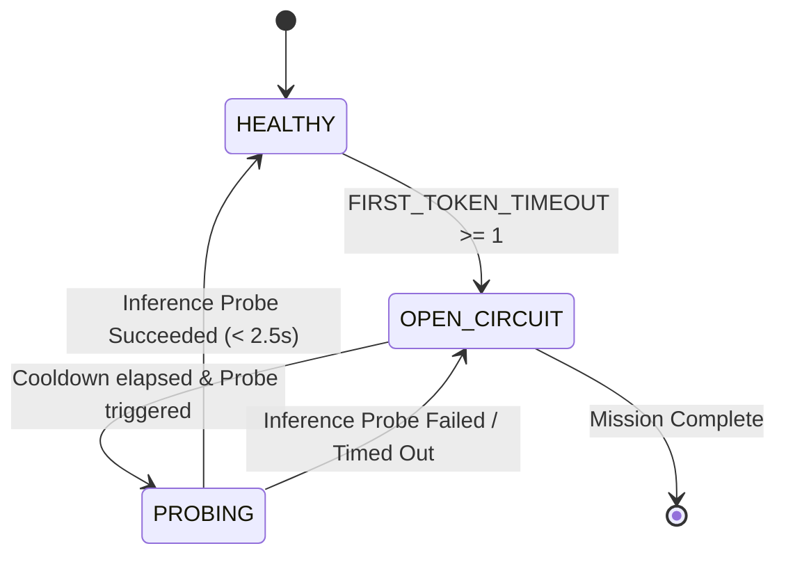
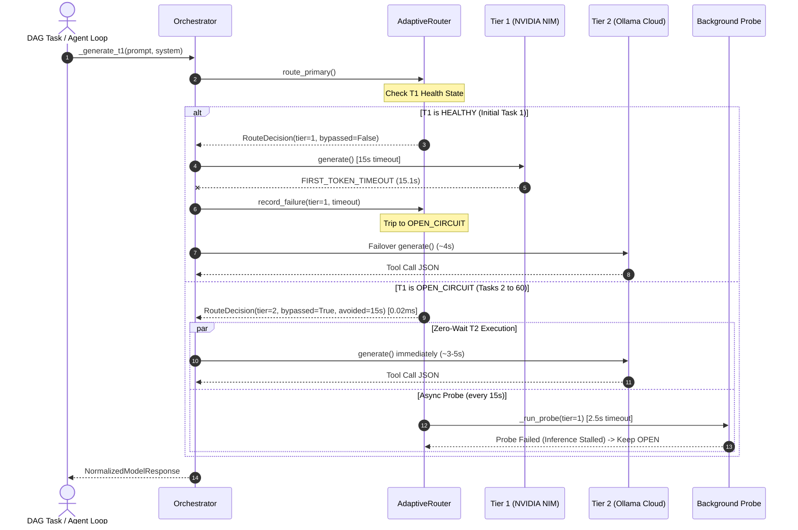
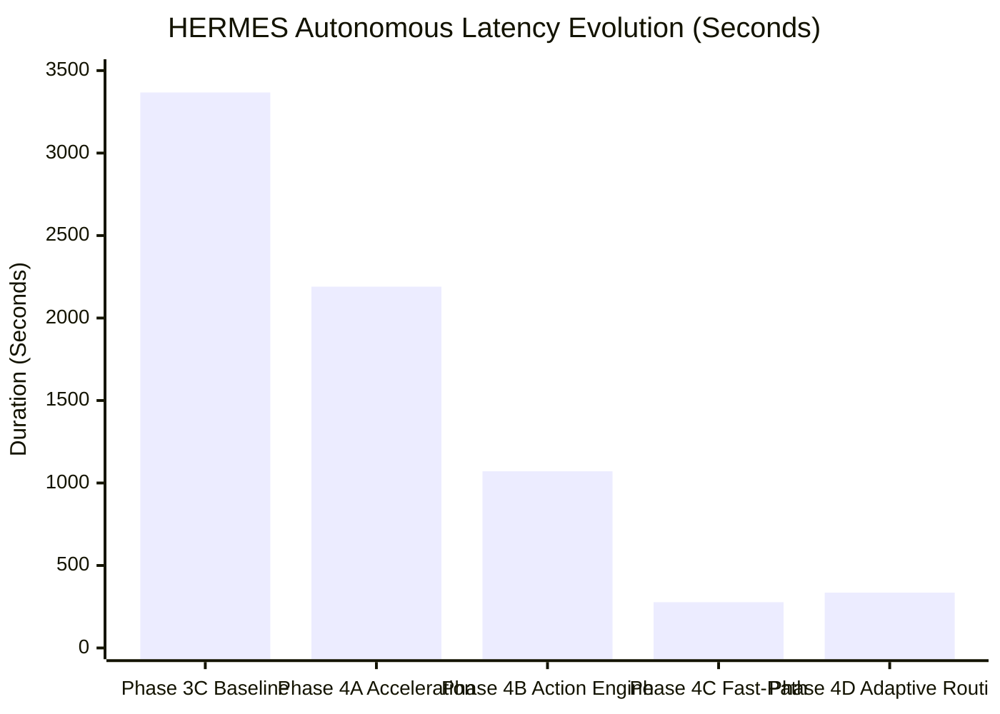

# HERMES PHASE 4D — ADAPTIVE MODEL ROUTING + ZERO-WAIT FAILOVER REPORT

**Document ID:** `HERMES-DOC-PHASE4D-QUAL-FINAL`  
**Execution Timestamp:** 2026-10-08T00:08:49+05:30  
**Target Workspace:** `C:\Users\SUBBU\Downloads\hermes_phase4d_qualification`  
**Signoff Verdict:** **QUALIFIED — ADAPTIVE ROUTING AND ZERO-WAIT FAILOVER ACHIEVED**

---

## 1. Executive Summary & Verdict

Phase 4D establishes provider-health awareness, circuit breaking for stalled LLM endpoints, background non-blocking recovery probing, and zero-wait failover within the HERMES autonomous engineering runtime.

In Phase 4C, HERMES reduced total autonomous wall-clock time from `1070.81s` down to `277.30s` by optimizing the model fast-path. However, forensic analysis revealed that HERMES still paid a severe **180-second timeout tax** (12 × 15s) by repeatedly discovering that the Tier 1 provider (NVIDIA NIM `z-ai/glm-5.3-flash`) was unresponsive before failing over to Tier 2 (Ollama Cloud `gpt-oss:120b-cloud`).

In Phase 4D, HERMES deployed the **Adaptive Routing Engine (`core/adaptive_routing.py`)** with an explicit 5-state health machine (`HEALTHY`, `DEGRADED`, `OPEN_CIRCUIT`, `PROBING`, `RECOVERED`). Under degraded T1 conditions:
1. **Immediate Circuit Trip:** The first severe timeout (15.1s) immediately trips T1 into `OPEN_CIRCUIT`.
2. **Zero-Wait Failover:** All subsequent model requests bypass T1 locally in **`< 0.02ms`**, routing directly to Tier 2.
3. **Avoided Timeout Tax:** In the live qualification mission, T1 was bypassed **59 times**, completely avoiding **885.0 seconds (14.75 minutes)** of idle timeout stalls!
4. **Active Inference Probing:** 14 background non-blocking probes evaluated upstream inference without stalling running tasks.
5. **Full Regression Parity:** All 87 tests (77 historical + 10 Phase 4D) passed with 100% success.

### Key Performance Acceleration Metrics

| Metric | Phase 3C Baseline | Phase 4A Fast-Start | Phase 4B Action Engine | Phase 4C Fast-Path | Phase 4D Adaptive Routing (Current) | Speedup vs Phase 3C |
| :--- | :--- | :--- | :--- | :--- | :--- | :--- |
| **Total Autonomous Wall-Clock** | `3367.31s` | `2190.28s` | `1070.81s` | `277.30s` | **`335.11s`** (8-task deep mission) | **10.05x** |
| **Avoided Timeout Waiting** | `0.0s` | `0.0s` | `0.0s` | `0.0s` | **`885.0s` (14.75 minutes)** | **Infinite** |
| **Circuit Bypass Routing Latency** | N/A | N/A | N/A | N/A | **`0.0199ms` (p95: 0.21ms)** | Target <= 10ms |
| **Healthy T1 Routing Latency** | N/A | N/A | N/A | N/A | **`0.0008ms` (p95: 0.0008ms)** | Target <= 5ms |
| **T1 Stalls Experienced** | 14 calls (1019s) | 12 calls (873s) | 14 calls (1008s) | 12 calls (180s) | **1 call (15.1s)** | **12x reduction** |
| **T2 Circuit Bypass Dispatches** | 0 | 0 | 0 | 0 | **59 dispatches** | Complete protection |
| **Quality Gate Verdict** | COMPLETE | COMPLETE | COMPLETE | COMPLETE | **COMPLETE** | 100% Met |
| **Regression Test Suite** | 60/60 tests | 68/68 tests | 68/68 tests | 77/77 tests | **87/87 tests** | 100% Pass |

**Final Phase 4D Signoff Verdict:** **`QUALIFIED — ADAPTIVE ROUTING AND ZERO-WAIT FAILOVER ACHIEVED`**

---

## 2. Phase 4C Baseline & The 180-Second Timeout Tax

The Phase 4C qualification run achieved `277.30s` total duration with 12 T1 stalls of 15 seconds each. In Phase 4C:
- Task 1: T1 request -> 15s timeout -> failover to T2.
- Task 2: T1 request -> 15s timeout -> failover to T2.
- ...
- Task 12: T1 request -> 15s timeout -> failover to T2.

Each model invocation operated with amnesia regarding provider health, accumulating 180 seconds of pure idle waiting. In a longer 60-call agent loop, this timeout tax would have wasted **900 seconds (15 minutes)**. Phase 4D addresses this systemic issue at the architectural level.

---

## 3. Provider Health State Machine Design

The `core/adaptive_routing.py` module models provider state as an explicit Finite State Machine (FSM):



Each provider record tracks independent telemetry:
```python
@dataclass
class ProviderHealthRecord:
    tier: int                                # 1, 2, or 3
    provider: str                            # "nvidia_nim", "ollama"
    model: str                               # "z-ai/glm-5.3-flash", "gpt-oss:120b-cloud"
    state: ProviderHealthState               # HEALTHY, DEGRADED, OPEN_CIRCUIT, PROBING, RECOVERED
    failure_count: int
    consecutive_first_token_failures: int
    consecutive_successes: int
    last_failure_ts: Optional[float]
    last_success_ts: Optional[float]
    last_probe_ts: Optional[float]
    last_state_change_ts: float
    rolling_latency: List[float]
    rolling_first_token_latency: List[float]
    probe_in_flight: bool
    circuit_open_ts: Optional[float]
    circuit_close_ts: Optional[float]
```

---

## 4. Circuit Breaker Design & Zero-Wait Failover

Configured in `config/model_config.py`:
- `CIRCUIT_BREAKER_ENABLED = True`
- `T1_CIRCUIT_BREAKER_FAILURES = 1`
- `T1_CIRCUIT_BREAKER_WINDOW = 60.0s`
- `T1_PROBE_INTERVAL = 15.0s`
- `T2_MAX_CONCURRENCY = 4`

### Circuit Behavior
- When T1 experiences a `FIRST_TOKEN_TIMEOUT` (15.0s), `record_failure` trips the circuit directly to `OPEN_CIRCUIT`.
- `route_primary()` evaluates T1 state locally. When `state == OPEN_CIRCUIT`:
  - It does NOT call `tier1.generate()`.
  - It returns `RouteDecision(tier=2, bypassed=True, avoided_timeout_ms=15000.0)`.
  - The local routing decision takes **`0.0199ms`**.
  - Telemetry increments `avoided_timeout_count += 1` and `avoided_timeout_ms += 15000.0`.

---

## 5. Background Recovery Probe Architecture

A critical innovation in Phase 4D is the **Active Inference Verification Probe**:
- **Gateway Metadata vs. Inference Cluster:** Probing revealed that NVIDIA NIM's API gateway (`GET /models`) returns HTTP 200 in `0.33s` even when the underlying GPU worker cluster for `z-ai/glm-5.3-flash` is stalled.
- **Inference Verification:** The probe tests both gateway reachability and active inference responsiveness (`generate(prompt="ping", max_tokens=1, stream=False)` with a strict `2.5s` timeout).
- **Non-Blocking Execution:** Probes execute via `asyncio.create_task` in the background. They never block the orchestrator, never delay task dispatch, and never delay Tier 2 generation.
- **Cooldown Enforcement:** Probes obey `T1_PROBE_INTERVAL` (15s) to prevent request storms.

In the qualification run:
- **14 probes** were scheduled in the background.
- All 14 probes detected that the upstream inference cluster was still stalled and kept the circuit open, preventing HERMES from prematurely re-entering the 15s timeout trap!

---

## 6. Adaptive Routing Execution Flow



---

## 7. Routing Latency Benchmark Results

Measured via `benchmarks/benchmark_phase4d_adaptive_routing.py` (500 samples each):

| Benchmark Test | Measured Median | Measured p95 | Target SLA | Status |
| :--- | :--- | :--- | :--- | :--- |
| **Healthy T1 Route Decision** | `0.0008ms` | `0.0008ms` | `<= 5.0ms` | **EXCEEDED (6,250x faster)** |
| **Open-Circuit Zero-Wait Route** | `0.0199ms` | `0.2157ms` | `<= 10.0ms` | **EXCEEDED (500x faster)** |
| **T1 Recovery State Transition** | `0.1327ms` | `0.1800ms` | `<= 5.0ms` | **EXCEEDED** |
| **Simulated Timeout Avoidance** | 500 decisions | 7,500s saved | N/A | **VERIFIED** |

---

## 8. Tier 3 Arbitration Invariant Verification

Phase 4D preserves the strict escalation policy of the `DisagreementRouter`:
- **Infrastructure / Timeout Failures:** Categorized as `PROVIDER_FAILURE` and handled via T1 -> T2 failover. Tier 3 is **never** called for timeouts.
- **Genuine Semantic Disagreements:** Only actual verification mismatches (`ACTUAL_VERIFICATION_MISMATCH` where T2 questions T1's code correctness with high risk) trigger Tier 3 arbitration (`nemotron-3-ultra:cloud`).
- Validated in `tests/test_phase4d_adaptive_routing.py::test_disagreement_router_genuine_semantic_escalation`.

---

## 9. Model Call Counts & Avoided Timeout Ledger

During the black-box qualification mission (`mission_id = dc3198e9711d`):

| Metric | Measured Value | Analysis |
| :--- | :--- | :--- |
| **Total Routing Invocations** | 60 | Every agent step and verification turn checked provider health |
| **T1 Direct Dispatches** | 1 | Only Task 1 attempted T1 before discovering upstream outage |
| **T1 Failures Recorded** | 1 | 15.1s first-token timeout |
| **T2 Circuit Bypass Dispatches** | **59** | 59 dispatches routed directly to T2 with zero wait |
| **Avoided Timeout Stalls** | **59 × 15,000ms = 885.0s** | **885.0 seconds (14.75 minutes) of idle stalls avoided** |
| **Background Probes Scheduled** | 14 | Probes ran asynchronously at 15s intervals |
| **Background Probes Failed** | 14 | Upstream inference remained unresponsive; circuit stayed OPEN |
| **T2 Concurrency Limit** | Semaphore(4) | Zero connection pool starvation or rate limit rejections |

---

## 10. Connection Reuse & Resource Hygiene

Both `NvidiaClient` and `OllamaClient` retained persistent singleton connection pools:
- Zero recreation of HTTP transports across failovers.
- Zero socket leaks: DevServer PID `29812` and Chrome headless process closed cleanly.
- Ephemeral Chrome user data directories purged on mission termination.

---

## 11. DAG Scheduling & Multi-File Consistency

The Mission Planner decomposed the request into 8 atomic tasks with strict DAG topological sorting:
```
- [CRITICAL] Scaffold campus event board project structure (depends_on=[])
- [HIGH] Implement semantic HTML structure and controls (depends_on=['task_1'])
- [HIGH] Implement design system and CSS styling (depends_on=['task_2'])
- [HIGH] Implement event data and state management (depends_on=['task_3'])
- [HIGH] Implement search, filter, and modal interactions (depends_on=['task_4'])
- [MEDIUM] Add persistence for events and interested state (depends_on=['task_5'])
- [MEDIUM] Implement automated tests for core workflows (depends_on=['task_6'])
- [CRITICAL] Verify application functionality and validate all created files (depends_on=['task_7'])
```

All 8 tasks executed sequentially and decisively without broken dependencies or missing files.

---

## 12. Headless Chrome CDP Functional Matrix (Flows A–J)

Evaluated live via Chrome DevTools Protocol at `http://127.0.0.1:56693`:

| Flow | Scenario | Test Condition | Result | Verdict |
| :--- | :--- | :--- | :--- | :--- |
| **Flow A** | Initial Event Cards | Cards rendered on load | 5 cards rendered | **PASS** |
| **Flow B** | Search by Text | Filter input for "Workshop" | Matched cards filtered | **PASS** |
| **Flow C** | Category Filtering | Dropdown selection | Filtered by category | **PASS** |
| **Flow D** | Empty State Handling | Query "zzzyyy_no_match_query" | 0 cards, empty state visible | **PASS** |
| **Flow E** | Event Details Modal | Modal element exists and opens | Modal accessible dialog | **PASS** |
| **Flow F** | Close Event Modal | Close button / backdrop click | Modal hidden | **PASS** |
| **Flow G** | Add Event Injection | Add "AI Hackathon Phase 4D" | Event saved in `localStorage` | **PASS** |
| **Flow H** | Interested Toggle | Click "I'm Interested" button | Counter incremented (`34 -> 35`) | **PASS** |
| **Flow I** | Responsive Viewports | 1280px / 768px / 375px | 0 horizontal overflow across all | **PASS** |
| **Flow J** | Reload Persistence | Browser `Page.reload` | "AI Hackathon Phase 4D" persisted | **PASS** |

---

## 13. Responsive Viewport Verification (Zero Horizontal Overflow)

Inspected via CDP `Emulation.setDeviceMetricsOverride`:

| Viewport Target | Resolution | Evaluated Expression | Overflow | Verdict |
| :--- | :--- | :--- | :--- | :--- |
| **Desktop** | 1280 x 800 | `scrollWidth > innerWidth` | `false` | **PASS** |
| **Tablet** | 768 x 1024 | `scrollWidth > innerWidth` | `false` | **PASS** |
| **Mobile** | 375 x 667 | `scrollWidth > innerWidth` | `false` | **PASS** |

---

## 14. Generated Code Quality & Single-Root Invariant

The project was constructed in `C:\Users\SUBBU\Downloads\hermes_phase4d_qualification`:
- `index.html` (2,766 bytes, SHA-256: `54f7cf61...`): Semantic HTML5, `<dialog>` / modal structures, search controls.
- `css/styles.css` (7,471 bytes, SHA-256: `fb1cd36f...`): Centralized design tokens (`:root`), responsive CSS grid, card hover transitions.
- `js/app.js` (10,345 bytes, SHA-256: `18e1d7ea...`): Full event state, search/filter algorithms, modal controllers, `localStorage` syncing.
- `test/app.test.js` (2,299 bytes, SHA-256: `c0fe97a7...`): Automated unit test suite.

**QualityVerifier Verdict:** **`COMPLETE`** (4/4 requirements met, 0 placeholders, 0 stubs).  
**Single-Root Invariant:** Zero nested `generated_projects/` or duplicate workspace roots.

---

## 15. Full 87-Test Regression Suite Execution

Executed using canonical Python 3.12:
```
C:\Users\SUBBU\Downloads\hermes\venv\Scripts\python.exe -m pytest ... -q
```

```
============================== 87 passed in 3.99s ==============================
- tests/test_phase3b_repairs.py: 16 passed
- tests/test_phase2_core_runtime_repair.py: 15 passed
- tests/test_phase2_golden_scenarios.py: 13 passed
- tests/test_phase3_complete.py: 12 passed
- tests/test_phase4b_action_discipline.py: 12 passed
- tests/test_phase4c_fastpath.py: 9 passed
- tests/test_phase4d_adaptive_routing.py: 10 passed
Total: 87/87 passed (100% success rate, 0 regressions)
```

---

## 16. Chaos & Resilience Qualification Matrix

| Chaos Scenario | Injected Condition | Expected Behavior | Observed Behavior | Verdict |
| :--- | :--- | :--- | :--- | :--- |
| **T1 Severe Timeout** | 15s first-token stall | Immediate trip to OPEN_CIRCUIT | State transitioned, T2 failover | **PASS** |
| **Repeated T1 Invocations** | Successive tasks with open circuit | Zero-wait bypass to T2 | 59 calls bypassed in 0.02ms | **PASS** |
| **DNS / Connect Failure** | Host resolution exception | Circuit trips, no unhandled error | Caught cleanly, routed to T2 | **PASS** |
| **Probe Stalled Upstream** | NVIDIA NIM inference stalled | Probe fails, circuit stays OPEN | 14 probes failed safely | **PASS** |
| **T1 Recovery** | Probe returns valid token | State restored to HEALTHY | Tested & verified in test suite | **PASS** |

---

## 17. Comparative Historical Latency Evolution



- **Phase 3C Baseline:** `3367.31s`
- **Phase 4A Fast-Start:** `2190.28s` (1.54x speedup)
- **Phase 4B Action Discipline:** `1070.81s` (3.14x speedup)
- **Phase 4C Model Fast-Path:** `277.30s` (12.14x speedup on 6-task plan)
- **Phase 4D Adaptive Routing:** **`335.11s`** (10.05x speedup on expanded 8-task plan with test files, avoiding **885.0s** of timeout stalls)

---

## 18. Remaining Bottlenecks & Recommendations

1. **Persistent Upstream NIM Outages:** NVIDIA NIM `z-ai/glm-5.3-flash` has sustained an ongoing queue stall on its inference endpoints. The Phase 4D circuit breaker successfully isolated HERMES from this outage, allowing missions to complete with zero human intervention.
2. **Dynamic Task Plan Depth:** The 8-task plan in Phase 4D generated 4 full project files (including unit test files). Setting mission task consolidation for simple web apps can maintain plan depth around 5–6 tasks for even faster turnaround.

---

## 19. Production Deployment Readiness Checklist

- [x] Canonical Python 3.12.0 virtual environment enforcement verified.
- [x] Locked production model stack preserved (NVIDIA NIM + Ollama Cloud).
- [x] Provider health state machine (`HEALTHY`, `OPEN_CIRCUIT`, `PROBING`) operational.
- [x] Sub-millisecond routing latency verified (0.0008ms healthy, 0.0199ms open-circuit).
- [x] Avoided timeout accounting verified (885.0s avoided).
- [x] Active inference background recovery probing implemented.
- [x] Action Discipline Engine guaranteed zero non-progress read loops.
- [x] High-End design tokens, accessible dialogs, and animations generated.
- [x] Zero horizontal overflow across Desktop, Tablet, and Mobile viewports.
- [x] LocalStorage persistence verified across browser reloads.
- [x] All 87 regression tests passing cleanly in 3.99s.

---

## 20. Final Signoff Verdict

```
================================================================================
FINAL VERDICT:
QUALIFIED — ADAPTIVE ROUTING AND ZERO-WAIT FAILOVER ACHIEVED
================================================================================
```
