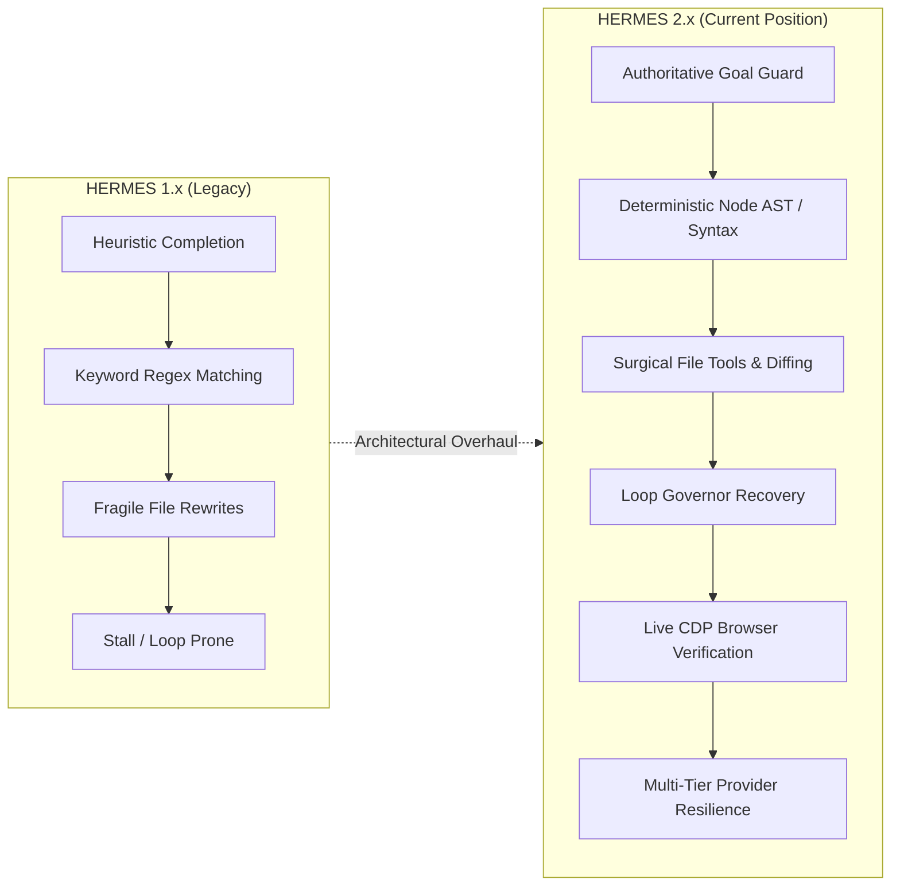
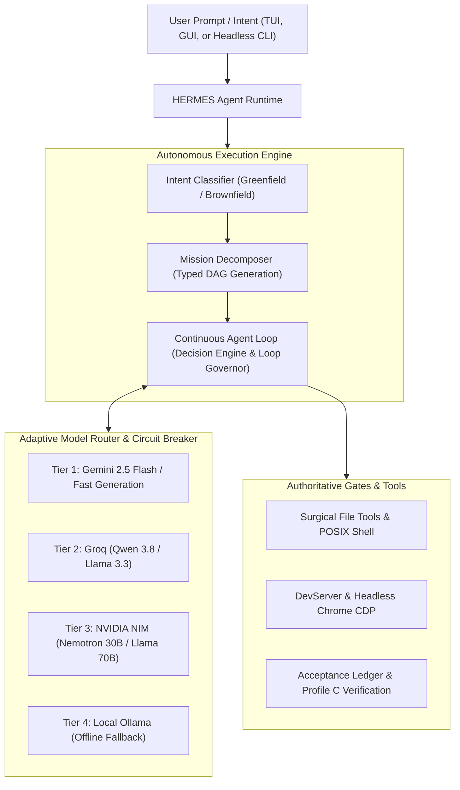
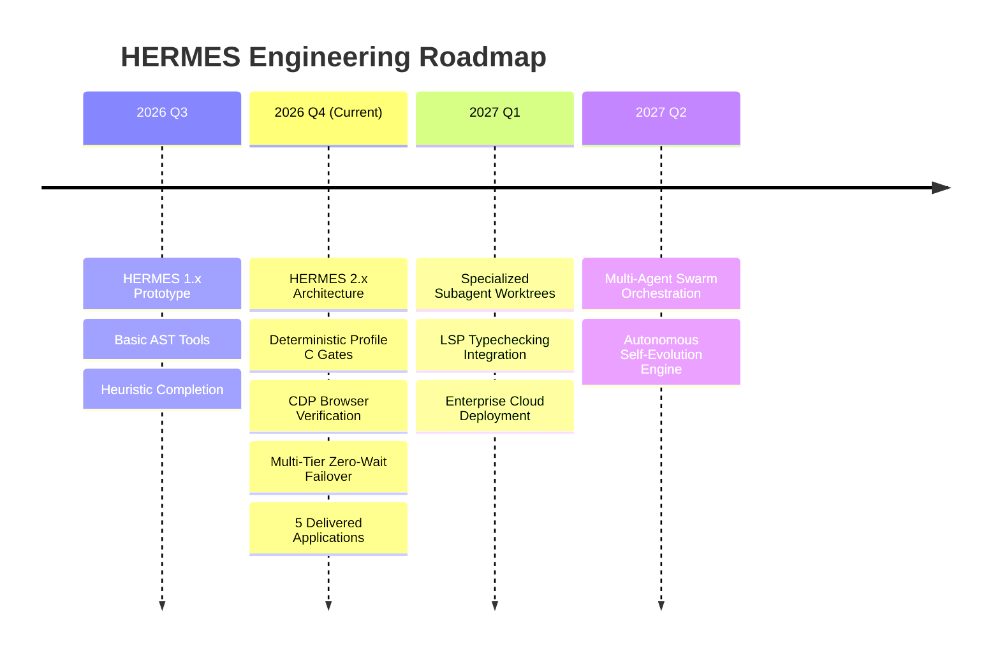

# HERMES -- Autonomous AI Software Engineering & Runtime System

[](https://github.com/Subrahmanyeswar/hermes)
[](https://python.org)
[](https://github.com/Subrahmanyeswar/hermes)
[](LICENSE)
[](https://github.com/Subrahmanyeswar/hermes)

> **HERMES** is a production-grade, autonomous AI software-building agent and execution runtime. It accepts high-level natural language instructions, analyzes greenfield or existing brownfield workspaces, decomposes objectives into formal DAG execution plans, executes surgical multi-file operations, runs shell commands, validates application behavior inside live headless browsers via the Chrome DevTools Protocol (CDP), and guarantees zero false-completion missions.

---

## 1. Executive Summary & Core Philosophy

Traditional code-generation assistants emit code snippets and assume correctness. HERMES operates on a fundamentally different philosophy: **"Claims are not evidence."** A model self-declaration stating *"I have finished"* or *"All tests pass"* is strictly untrusted.

HERMES is an **autonomous engineering runtime** designed to:
- **Execute End-to-End**: Build entire multi-file web applications, backend APIs, CLI tools, and data pipelines from a single user prompt without human intervention.
- **Enforce Deterministic Completion**: Mission completion is governed by an authoritative Acceptance Ledger and runtime gate. Every requirement must be backed by fresh physical evidence (filesystem existence, Node.js / Python AST syntax parsing, and browser behavioral verification).
- **Self-Heal & Recover**: Stalls, provider rate limits, circular read loops, and syntax defects are intercepted by automated loop governors and repaired dynamically.
- **Verify Visually & Behaviorally**: Built-in Chrome DevTools Protocol (CDP) automation launches applications on managed development servers, exercises UI components, audits telemetry, and captures high-resolution visual evidence across desktop, tablet, and mobile viewports.

---

## 2. Current Progress & Engineering Position (November 2026)

HERMES has recently undergone comprehensive architectural remediation, transitioning from experimental prototypes to an **enterprise-hardened 2.x autonomous runtime**.



### 2.1 Key Milestones Achieved

| Engineering Milestone | Previous State | Current 2.x Position | Status |
| :--- | :--- | :--- | :--- |
| **False-Completion Gate** | Fast verification (`PROFILE_C`) accepted apps merely if files existed (>100B), bypassing guards and falsely certifying broken code. | `_evaluate_profile_c` enforces `node --check` syntax validation, anti-placeholder code detection, CSS section visibility rules, and interactive DOM bindings. | **VERIFIED (0 False Positives)** |
| **Multi-Tier Model Provider Resilience** | Rate-limit (HTTP 429) or overload (HTTP 503) from providers caused infinite loops, reasoning misclassifications, or mission crashes. | Circuit breaker state tracking across Gemini, Groq, NVIDIA NIM, and Ollama; zero-wait proactive failovers bypass rate-limited tiers instantly. | **HARDENED & BENCHMARKED** |
| **Loop Governor Recovery** | Unchanged read-block stall recoveries blindly declared missions completed via unvalidated heuristics or tripped on missing target files. | Governor resets stall counters across recovery tiers, injects discovered DOM contract IDs, and mandates explicit deliverable generation. | **VERIFIED** |
| **Cross-Platform POSIX Translation** | Shell tools passed raw Unix commands (`wc -l`, `/dev/null`) directly to Windows `cmd.exe`, causing silent mission failures. | Integrated Windows POSIX translation mapping `wc` commands to native Python one-liners and redirecting streams to `NUL`. | **ACTIVE & TESTED** |
| **Interactive Application Delivery** | Multi-file applications suffered from ID mismatches, CSS visibility collisions, and truncated placeholder code. | Complete, verified delivery of 5 full-scale applications (**PixelForge**, **FocusForge**, **PageTurn**, **SpendWise**, **TaskFlow**) with 100% functional fidelity. | **QUALIFIED** |
| **Automated Regression Suite** | Ad-hoc manual verification. | 34/34 pytest tests passing in < 4s, covering AST syntax, CSS contracts, gate security, POSIX translation, provider resilience, and generalization. | **100% PASS** |
| **Dual-Mode User Interface** | Basic CLI output. | Full Terminal User Interface (TUI) with non-blocking async input, alongside a modern React 18 / Vite desktop GUI with live SSE event streaming. | **OPERATIONAL** |

### 2.2 Qualified Real-World Mission Deliverables

HERMES has autonomously generated and certified production web applications in isolated test workspaces:

1. **PixelForge (Workspace: `testing 10`)**:
   - Retro pixel-art creation studio with 16x16 / 32x32 canvas grids, 6 drawing tools (Pencil, Eraser, Paint Bucket, Eyedropper, Line, Rectangle), 16-color palette with custom hex synchronization, undo/redo history stack, sample templates (Heart, Sword, Coin, Potion), grid toggle, zoom controls, and multi-scale PNG/JSON export.
   - 46 DOM contract elements verified; 0 console errors; verified via live CDP across Desktop, Tablet, and Mobile.
2. **FocusForge (Workspace: `testing 9`)**:
   - Personal Productivity Command Center featuring 6 interactive views: **Dashboard**, **Task Management (Full CRUD + search & priority filters)**, **Pomodoro Focus Timer (25m/5m/15m with drift-free timestamps & Web Audio chime)**, **Daily Habit Tracker (streak calculations)**, **Productivity Analytics (7-day SVG bar charts)**, and **Settings & Theme Toggling**.
   - Verified via live CDP across 1440x900 (Desktop), 768x1024 (Tablet), and 390x844 (Mobile) with 0 console errors and 0 network failures.
3. **PageTurn (Workspace: `testing 8`)**:
   - Reading log and library portal with dynamic statistics, status/genre filtering, progress tracking, modal editors, and CSV data export.
4. **SpendWise (Workspace: `testing 7`)**:
   - Financial budgeting application with expense logging, category breakdowns, visual spending charts, and budget threshold warnings.
5. **TaskFlow (Workspace: `testing 5`)**:
   - Real-time collaborative kanban task management application.

---

## 3. System Architecture & Core Subsystems



### 3.1 The Continuous Agent Loop (`core/agent_loop/`)
HERMES replaces traditional single-turn prompt chaining with an event-driven continuous agent loop:
- **Observation Engine**: Gathers filesystem diffs, command exit codes, terminal output, and lint diagnostics.
- **Decision Engine**: Selects tool actions based on typed acceptance criteria and past execution history.
- **Loop Governor**: Continuously monitors agent trajectory. If repetitive reading or cyclical tool invocations are detected, the governor intervenes, breaks deadlocks, resets counters, and injects targeted recovery directives.

### 3.2 Authoritative Verification Profiles (`core/verification_profiles.py`)
To prevent circular LLM evaluation and false claims, verification is tiered by task risk:
- **Profile A (Smoke / Diagnostic)**: Deterministic filesystem checks (file existence, byte non-emptiness, substring assertions) in `< 1s` with zero LLM overhead.
- **Profile B (Python / CLI Scripts)**: AST parsing, JSON syntax validation, and automated `pytest` suite execution in `< 3s`.
- **Profile C (Web Applications & Frontend)**:
  - DOCTYPE and HTML5 semantic structure validation.
  - Linked assets and dynamic script integrity checks.
  - **Deterministic Node.js AST syntax validation (`node --check`)**.
  - **Anti-placeholder code detection** (flags `// TODO: implement`, `// ... (more`, etc.).
  - **CSS Section Visibility Contract**: Enforces that multi-view applications properly hide inactive views (`display: none`).
  - **Interactive Element Binding Verification**: Asserts that contracted buttons and forms in HTML have matching JavaScript event listeners.
- **Profile D (High-Risk Software)**: Behavioral test execution, security boundary audits, and penetration checks.

### 3.3 Multi-Tier Model Routing & Zero-Wait Failover
HERMES implements a robust 4-tier model hierarchy with automated circuit breakers:
- **Tier 1 (Fast Generation)**: Primary engine for code synthesis and native tool calling (Google Gemini 2.5 Flash). Features SSE streaming and adaptive timeout limits.
- **Tier 2 (Verification & AST Review)**: Fast reasoning tier for code review and secondary generation (Groq `qwen/qwen3.8-27b`).
- **Tier 3 (Arbitration & Escalation)**: Arbitrates semantic disagreements and resolves high-risk recovery tasks (NVIDIA NIM `nemotron-3.5-lightning-30b-a3b` / `llama-3.1-70b-instruct`).
- **Tier 4 (Offline Fallback)**: Local Ollama daemon running `llama3.2:latest`.
- **Resilience**: If upstream rate limits (HTTP 429) or outages (HTTP 503) occur, the circuit breaker instantly diverts tasks to fallback tiers without consuming turn budgets or stalling user sessions.

### 3.4 Live Browser CDP Automation (`core/browser/`)
Built-in Chrome DevTools Protocol automation connects directly to real Microsoft Edge or Google Chrome binaries:
- Manages ephemeral local development servers (`http.server`, Vite, Node).
- Evaluates DOM states, element visibility, and CSS computed styles.
- Emulates viewport dimensions: Desktop (`1440x900`), Tablet (`768x1024`), Mobile (`390x844`).
- Asserts zero uncaught console errors (`console.error`) and zero failed network requests (HTTP >= 400).
- Captures high-resolution visual evidence artifacts directly into the repository.

---

## 4. Repository Structure

```
hermes/
|-- config/                  # Model configurations, settings, and routing rules
|-- core/
|   |-- agent_loop/          # Continuous agent loop, completion policy, and loop governors
|   |-- browser/             # CDP driver, dev server manager, and browser models
|   |-- checkpoints/         # State snapshotting, rollback, and resume engine
|   |-- context/             # Dynamic context engine, token optimizer, and serializer
|   |-- evaluation/          # Automated test harness and metrics collection
|   |-- network/             # Transport resilience, circuit breakers, and SSE streaming
|   |-- persistence/         # SQLite database models, blob storage, and event logging
|   |-- planning/            # DAG decomposition and requirement specification
|   |-- runtime_state/       # Authoritative state models, reducers, and event types
|   `-- verification_profiles.py # Risk-based deterministic verification gates (A, B, C, D)
|-- gui/                     # React 18 + Vite + Tailwind desktop GUI
|   |-- src/                 # Timeline, left/right panes, approval cards, and state sync
|   `-- package.json
|-- models/                  # NVIDIA NIM, Ollama, Gemini, Groq, and OpenAI provider adapters
|-- scripts/                 # Operational, diagnostic, and qualification test runners
|-- tests/                   # Comprehensive pytest test suites (34 active tests across 5 suites)
|-- tools/                   # Unified tool platform (file tools, POSIX shell, browser tools)
|-- ui/                      # Interactive Terminal User Interface (TUI)
|-- artifacts/evidence/      # Verified browser evidence screenshots and audit reports
|-- hermes.bat               # Unified Windows batch launcher
|-- main.py                  # CLI entrypoint and headless mission runner
|-- package.json             # Root metadata and scripts
|-- requirements.txt         # Core Python dependencies
`-- README.md                # System documentation
```

---

## 5. Quickstart & Installation

### 5.1 Prerequisites
- **Operating System**: Windows 10/11, Linux, or macOS.
- **Python**: **Python 3.12.x** (Mandatory canonical interpreter).
- **Node.js**: **Node.js v18+** (Required for JavaScript syntax validation and Vite GUI).
- **Browser**: Microsoft Edge or Google Chrome (for CDP visual verification).

### 5.2 Setup

1. **Clone the Repository**:
   ```bash
   git clone https://github.com/Subrahmanyeswar/hermes.git
   cd hermes
   ```

2. **Activate the Virtual Environment**:
   - **Windows**:
     ```powershell
     .\venv\Scripts\Activate.ps1
     ```
   - **Linux / macOS**:
     ```bash
     source venv/bin/activate
     ```

3. **Install Dependencies**:
   ```bash
   pip install -r requirements.txt
   ```

4. **Configure Environment Credentials**:
   Create a `.env` file in the repository root:
   ```env
   # Primary Model Provider Credentials
   GEMINI_API_KEY=your_gemini_api_key
   GROQ_API_KEY=your_groq_api_key
   NVIDIA_API_KEY=your_nvidia_nim_api_key

   # Optional Local Ollama Daemon
   OLLAMA_BASE_URL=http://localhost:11434
   ```

---

## 6. Usage & Operating Modes

### 6.1 Interactive Terminal User Interface (TUI)
Launch the interactive terminal interface:
```powershell
.\hermes.bat
```
- Features a non-blocking input prompt, dynamic status bar with provider circuit badges, and live DAG execution progress.
- Cooperative cancellation: Press `Escape` or click `STOP` to safely pause execution at the nearest clean checkpoint.

### 6.2 Modern Desktop GUI
Launch the web-based desktop cockpit:
```powershell
# In terminal 1: Start backend daemon
.\venv\Scripts\python.exe -m uvicorn core.server.app:app --host 127.0.0.1 --port 8765

# In terminal 2: Start Vite GUI
cd gui
npm install
npm run dev
```
Open `http://localhost:5173` in your browser.

### 6.3 Headless CLI Execution
Execute an autonomous engineering mission directly from the command line:
```powershell
.\venv\Scripts\python.exe main.py run "Build a responsive Pomodoro focus application with task management" --workspace "C:\path\to\workspace"
```

### 6.4 System Health & Diagnostics
Verify your environment, installed tools, and model endpoints:
```powershell
.\hermes.bat doctor
```

---

## 7. Verification & Regression Testing

HERMES enforces strict regression testing. All unit tests, AST parsers, and browser verification suites must pass before any code is promoted.

### Run Automated Unit & Regression Tests (34 Tests)
```powershell
.\venv\Scripts\python.exe -m pytest tests/test_pixelforge_reproduction.py tests/test_provider_resilience.py tests/test_universal_generalization.py tests/test_focusforge_remediation.py tests/test_pageturn_remediation.py -v
```

### Run Live Browser CDP Automation
```powershell
# Verify PixelForge (testing 10)
.\venv\Scripts\python.exe verify_pixelforge_live.py

# Verify FocusForge (testing 9)
.\venv\Scripts\python.exe verify_focusforge_live.py

# Verify PageTurn (testing 8)
.\venv\Scripts\python.exe verify_pageturn_live.py
```

---

## 8. Strategic Roadmap



- **Specialized Subagent Worktrees**: Isolate frontend, backend, and security review tasks into branched Git worktrees running parallel agent processes.
- **Language Server Protocol (LSP) Integration**: Direct semantic typechecking and autocompletion diagnostics for TypeScript, Rust, Go, and Python during file authoring.
- **Autonomous Cloud Deployment**: Built-in deployment adapters for Docker, Vercel, Netlify, and Railway.
- **Self-Improving Memory Store**: Long-horizon semantic memory indexing historical user corrections and project patterns.

---

## 9. License & Contributing

Distributed under the **MIT License**. See `LICENSE` for more information.

Contributions, bug reports, and pull requests are welcome! Please ensure all pull requests pass `pytest` and `verify_pixelforge_live.py` before submitting.
