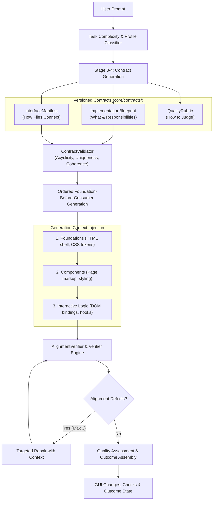

# HERMES Phase 11 — Architectural Specification: High-End Code Generation, Cross-File Alignment & Quality Enforcement

**Release:** HERMES v1.0.0-rc1  
**Phase:** 11 — High-End Code Generation, Cross-File Alignment, Architectural Coherence & Quality-Enforced Execution  
**Platform:** Windows 11 / AMD64  
**Date:** 2026-10-13  
**Status:** Architecture Implemented & Regression-Locked (159/159 Tests Passing)  

---

## 1. Architectural Overview

HERMES Phase 11 introduces a contract-driven code generation architecture designed to solve two fundamental problems demonstrated in prior versions:
1. **Problem A — Cross-File Incoherence:** Mismatched DOM IDs, broken CSS classes, dead internal links, missing imports/exports, and uncoordinated per-file code generation.
2. **Problem B — Toy-Level and Skeletal Code Generation:** Trivial scaffolds generated by fast-path bypasses, missing responsive designs, empty stubs, and models running out of tokens during reasoning.

---

## 2. Core Architectural Components

### 2.1 The Three Versioned Contracts (`core/contracts/`)
1. **`ImplementationBlueprint`:** Authoritative specification of project intent, planned files, ordered sections, features, and route structures.
2. **`InterfaceManifest`:** Authoritative specification of shared DOM IDs, CSS classes, event hooks, module imports/exports, and internal links.
3. **`QualityRubric`:** Authoritative specification of hard requirements (syntax, alignment, dead links) and weighted quality dimensions (visual depth, responsive design, interactivity).

### 2.2 Deterministic Contract Validation (`core/contracts/validator.py`)
Before any code generation turn is initiated, the `ContractValidator` inspects the contracts for:
- **Dependency Acyclicity:** DFS cycle detection across `FilePlan.dependencies`.
- **DOM ID Uniqueness:** Duplicate element IDs within the same file are strictly rejected.
- **File Ownership Integrity:** Manifest items cannot reference files not planned in the blueprint.
- **Link Integrity:** Internal links must resolve to planned pages.

### 2.3 Backward-Compatible State Persistence & Migrations
The contracts are deeply integrated into `HermesRuntimeState` in `core/runtime_state/models.py` and the serializer in `core/persistence/serializer.py`:
- **Safe Fallback Defaults:** Checkpoints from Phases 0–10 that lack contract fields deserialize cleanly with `None` values and zero errors.
- **Deterministic Hashing:** Serialized contracts compute SHA-256 fingerprints across canonical sorted JSON keys.
- **Full Round-Trip Fidelity:** `deserialize(serialize(state))` reproduces identical state and matching cryptographic hashes.

---

## 3. Verifier Integration & Bounded Repair

The verification pipeline integrates the contracts with deterministic static checks and multi-tier evaluation:
1. **Static AST & Regex Alignment:** Analyzes actual files on disk against the `InterfaceManifest` (verifying that every DOM ID queried in JS exists in HTML and every link resolves).
2. **Anti-Placeholder Gate:** Rejects `// TODO` stubs, generic lorem ipsum text, and empty callbacks.
3. **Bounded Repair Workflow:** When alignment verifier detects discrepancies (e.g. mismatched ID), it triggers a targeted repair turn carrying the full content of the sibling dependency rather than regenerating from scratch (bounded to max 3 attempts).

---

## 4. Preservation of Phases 0–10 Guarantees

All core runtime invariants from previous phases remain strictly protected:
- **Phase 1–5:** Mission lifecycle, Stop, Resume, Pause, and terminal state immutability.
- **Phase 6–7:** Transport connection pooling, retry policies, and network recovery.
- **Phase 8:** Project Hub workspace registry isolation (`recent_workspaces.json`).
- **Phase 9:** Micro-batched SQLite persistence and CAS file snapshotting.
- **Phase 10:** Fault injection tolerance, process interruption safety, and browser acceptance.
- **Verification Status:** **159/159 tests passing** in 26.81s with 0 warnings.
