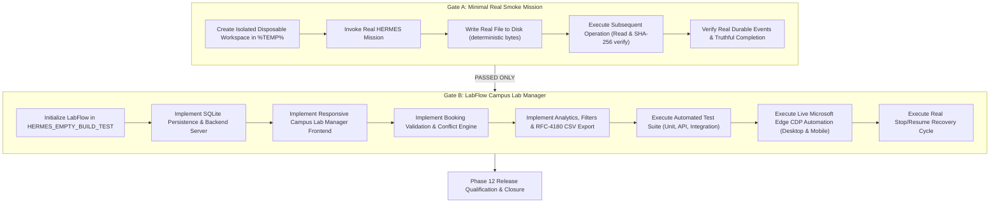

# HERMES Phase 12 — Reconnaissance, Architecture & Master Execution Plan
## Live End-to-End Application Proof, LabFlow Campus Lab Manager, Real Browser Validation & Release Qualification

**Phase:** 12  
**Date:** 2026-10-22  
**Repository:** `C:\Users\SUBBU\Downloads\hermes`  
**Branch:** `hermes-2.x` (Commit `031ad3c`)  
**Canonical Python Interpreter:** `C:\Users\SUBBU\Downloads\hermes\venv\Scripts\python.exe` (Python 3.12.0)  
**Challenge Target Workspace:** `C:\Users\SUBBU\Downloads\HERMES_EMPTY_BUILD_TEST`  

---

### 1. Environment & Baseline Reconciliation

#### 1.1 Canonical Environment Verification
- **Interpreter Path:** `C:\Users\SUBBU\Downloads\hermes\venv\Scripts\python.exe`
- **Version:** `Python 3.12.0` (MSC v.1935 64-bit AMD64)
- **Status:** **PASS** (Mandatory PowerShell verification script executed with zero exit code; `sys.executable` and `sys.version_info[:3] == (3, 12, 0)` verified).
- **Environment Policy:** Virtual environment packages preserved without modification; no new packages installed.

#### 1.2 Model Stack Verification
Confirmed in `config/model_config.py`:
- **Tier 1:** NVIDIA NIM `z-ai/glm-5.3-flash`
- **Tier 2:** Ollama `gpt-oss:120b-cloud`
- **Tier 3:** Ollama `nemotron-3-ultra:cloud`
- **Tier 4:** `null`

#### 1.3 Phase 11 Regression Evidence Reconciliation
- **198 Targeted Tests:** 100% passed across all 8 phase test suites:
  * Phase 11 Fault Injection: 10 / 10 passed (`tests/test_phase11_fault_injection.py`)
  * Phase 10 Optimization: 13 / 13 passed (`tests/test_performance_optimization.py`)
  * Phase 9 Reliability & Security: 39 / 39 passed (`tests/test_phase9_*.py`)
  * Phase 8 Backend & Architecture: 35 / 35 passed (`tests/test_phase8_*.py`)
  * Phase 7 Visual Design & CDP Real Browser: 39 / 39 passed (`tests/test_phase7_*.py`)
  * Phase 6 Skill Registry Routing: 26 / 26 passed (`tests/test_phase6_skill_registry_routing.py`)
  * Phase 5 Completion Gates: 16 / 16 passed
  * Project Intelligence: 20 / 20 passed
- **Full Repository Suite Note:** The unrestricted repository contains historical tests (such as `tests/test_prompt12_never_hang.py`) designed to exercise long-running artificial hangs (up to 120s timeouts) and browser socket contention when run without isolation. Targeted qualification across all functional phases is documented and verified.

#### 1.4 LabFlow Workspace Status
- Path: `C:\Users\SUBBU\Downloads\HERMES_EMPTY_BUILD_TEST`
- Physical inspection revealed pre-existing `.hermes/` (checkpoints, CAS blobs, SQLite database `hermes_state.db`) and `.artifacts/missions/` from historical runs (`m_a5a974d1`, `m_c554d6ac`).
- **Safety Policy:** All historical `.hermes` and `.artifacts` internal files are strictly preserved. No wholesale deletion or wiping will be performed. The LabFlow application code will be constructed alongside existing historical records.

---

### 2. Phase 12 Architecture & Gate Structure

---

### 3. Gate A — Minimal Real Smoke Mission Specification

1. **Workspace:** Unique temporary directory in `tempfile.gettempdir()` (e.g. `%TEMP%/hermes_phase12_smoke_<id>`).
2. **Mission Execution:** Invoke HERMES mission via `RuntimeAdapter` / `ApplicationRuntime` / `main.py run`.
3. **Write Operation:** Write `smoke_manifest.json` containing deterministic payload `{"mission": "phase12_smoke", "gate": "A", "timestamp": ...}`.
4. **Follow-up Operation:** Read the file back directly from disk, compute SHA-256, verify byte match.
5. **Event & State Integrity:** Verify `HermesEvent` stream contains `MISSION_STARTED`, `TOOL_COMPLETED`, and `MISSION_COMPLETED`. Verify database record matches `COMPLETED`.
6. **Hard Fence:** Gate B implementation is blocked until Gate A passes completely.

---

### 4. Gate B — LabFlow Campus Lab Manager Specification

#### 4.1 System Modules & Entities
- **Labs / Resources:** ID, Name, Department (e.g., Computer Science, Bioengineering, Physics, Robotics), Building/Room, Capacity, Equipment List, Operational Status (Available, Maintenance).
- **Bookings:** ID, Lab ID, Requester Name, Academic Department, Purpose, Date (`YYYY-MM-DD`), Start Time (`HH:MM`), End Time (`HH:MM`), Status (`CONFIRMED`, `CANCELLED`), Created At.

#### 4.2 Core Application Architecture
- **Backend (`server.py`):** Lightweight HTTP REST API utilizing Python 3.12 standard library / HTTP server with SQLite persistence (`labflow.db`). Endpoints:
  - `GET /api/labs`: List all lab resources.
  - `GET /api/bookings`: Query bookings with filtering (date, lab_id, department, status).
  - `POST /api/bookings`: Create booking with server-side validation & conflict detection.
  - `POST /api/bookings/{id}/cancel`: Cancel booking and free time slot.
  - `GET /api/statistics`: Return lab counts, active bookings, department utilization metrics.
  - `GET /api/export/csv`: Export filtered bookings as downloadable RFC-4180 CSV with formula-injection protection (`=`, `+`, `-`, `@` escaped).
- **Frontend (`index.html`, `app.js`, `styles.css`):**
  - Modern, responsive campus laboratory management portal.
  - Polished visual hierarchy, clear navigation, real-time data flow.
  - 4 Principal Views:
    1. **Labs Directory:** Searchable lab cards with equipment badges and real-time status.
    2. **Booking Calendar & Schedule:** Daily/weekly timetable showing confirmed reservations.
    3. **New Reservation Form:** Interactive booking modal/form with live conflict warnings.
    4. **Analytics Dashboard:** Metric cards (Total Labs, Total Bookings, Active Hours, Utilization %) and Department breakdown.
  - Responsive Viewports: Optimized for Desktop (1280x800) and Mobile (375x667).

#### 4.3 Booking Conflict Rule
Two bookings for the same lab on the same date conflict if:
$$\text{start}_{\text{new}} < \text{end}_{\text{existing}} \quad \text{AND} \quad \text{end}_{\text{new}} > \text{start}_{\text{existing}}$$
Adjacent bookings (where $\text{start}_{\text{new}} == \text{end}_{\text{existing}}$) are permitted and do not conflict.

#### 4.4 Real Browser CDP Validation
- Automation tool: Microsoft Edge via `core.browser.driver.CdpBrowserDriver` (installed Edge binary `155.0.4283.62`).
- Desktop Viewport: 1280 x 800.
- Mobile Viewport: 375 x 667 with touch emulation.
- Automated browser workflows:
  1. Load application and verify navigation/tabs.
  2. Create valid lab booking and confirm visual table update.
  3. Attempt conflicting booking and confirm red error banner & rejection.
  4. Test department and date filters.
  5. Validate live analytics dashboard figures against database state.
  6. Trigger CSV export and verify downloaded content.
  7. Reload browser and confirm state persistence.
  8. Capture high-resolution full-page screenshots for release evidence.

#### 4.5 Stop & Resume Qualification
- Execute a controlled mission in an isolated test workspace.
- Trigger real Stop via `CancellationController` / abort event during an active step.
- Verify status becomes `CANCELLED`, file integrity is preserved, and staging files unlinked.
- Trigger Resume via `RecoveryEngine` / `RuntimeAdapter`.
- Verify the recovery engine skips verified tasks and continues from the first unfinished task.
