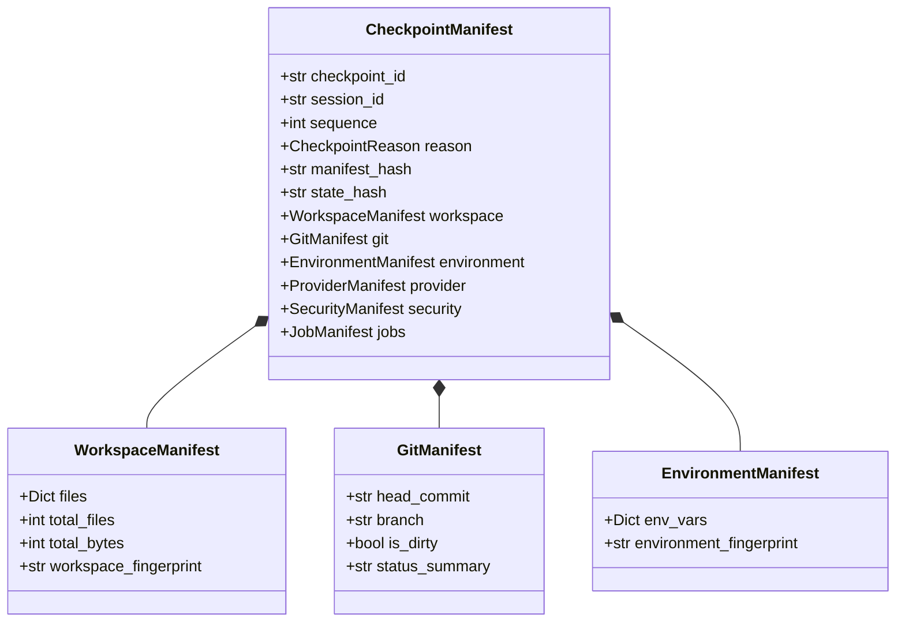

# HERMES 2.x — Checkpoint & Persistence Architecture

## 1. Overview & Core Invariants

Prompt 14 elevates HERMES 2.x from an ephemeral execution loop into an authoritative, durable agent runtime. State survives sudden power loss, process interruption, network termination, and agent thrashing.

### Foundational Invariants:
1. **Zero Pickle:** Persistent runtime state is serialized strictly using deterministic, schema-versioned JSON (`SCHEMA_VERSION = 1`, `RUNTIME_VERSION = "2.0.0"`).
2. **Side-Effect-Free Replay:** Journal replay is a pure state reduction ($S_{n} = \text{reduce}(S_{n-1}, E_n)$). It executes **zero** tools, makes **zero** model requests, and triggers **zero** filesystem mutations.
3. **Immutable Checkpoints:** Once committed, a checkpoint manifest and its referenced CAS blobs are permanent and read-only.
4. **Content-Addressed Storage (CAS):** File and state blobs are keyed by SHA-256 (`.hermes/blobs/ab/cdef...`) with automatic deduplication across checkpoints and branches.
5. **Atomic Workspace Operations:** Checkpoint manifests, journal entries, and restored workspace files are committed using tempfile fsync and atomic rename (`os.replace`) with Windows-resilient retry loops.

---

## 2. Storage Subsystem & Directory Layout

All persistence artifacts reside in the project-local `.hermes/` directory:

```text
.hermes/
├── hermes.db               # SQLite database (WAL mode, foreign keys, synchronous=NORMAL)
├── hermes.db-wal           # SQLite Write-Ahead Log
├── hermes.db-shm           # SQLite Shared Memory
├── blobs/                  # Content-Addressed Storage (CAS)
│   ├── 0a/                 # 2-character hex prefix sharding
│   │   └── 0a1b2c3d...     # Raw immutable payload verified by SHA-256
│   └── 3f/
│       └── 3fa8b912...
└── checkpoints/            # Filesystem checkpoint manifests
    └── chk_a1b2c3d4/
        └── manifest.json   # Redundant fallback copy of CheckpointManifest
```

### SQLite Schema:
- **`sessions`**: `session_id`, `mission_id`, `workspace_root`, `status`, `parent_session_id`, `root_session_id`, `branch_name`, `current_checkpoint_id`, `created_at`, `updated_at`, `metadata`.
- **`checkpoints`**: `checkpoint_id`, `session_id`, `sequence`, `reason`, `manifest_hash`, `state_hash`, `manifest_json`, `created_at`.
- **`journal`**: `session_id`, `sequence`, `event_id`, `event_type`, `payload_hash`, `payload_json`, `timestamp`. Monotonically indexed `(session_id, sequence)`.
- **`transcripts`**: `session_id`, `message_index`, `message_type`, `author_role`, `content_text`, `payload_blob_id`, `tool_call_id`, `timestamp`.
- **`locks`**: `session_id` (PK), `owner_pid`, `owner_host`, `acquired_at`, `heartbeat_at`.

---

## 3. Checkpoint Manifest Domain Model

Every checkpoint records a complete multi-domain system snapshot:



1. **Workspace Manifest (`WorkspaceSnapshotter`):** Scans non-ignored workspace files into CAS blobs. Enforces strict directory containment, forbidding symlink and junction path escapes.
2. **Git Manifest (`GitSnapshotter`):** Non-destructive Git inspection (`git rev-parse HEAD`, `git status --porcelain`). Strictly scrubs tokens and credentials from remote URLs.
3. **Environment Manifest (`EnvironmentSnapshotter`):** Allowlisted capture of environment variables (`PYTHON_VERSION`, `HERMES_MODE`, `TIER1_PROVIDER`, `MODEL_NAME`, `HERMES_ENV`). Secrets, keys, and tokens are aggressively filtered and redacted.
4. **Provider Manifest:** Snapshot of active provider sockets, circuit breaker state, active request identifiers, and token totals.
5. **Security Manifest:** Active approval grants, unexpired waivers, risk counters, and denial history.
6. **Job Manifest:** Active background jobs, subagents, and worktrees.

---

## 4. Transcript Store & Copy-on-Write (COW) Forking

- **Typed Messages:** `USER`, `ASSISTANT`, `SYSTEM`, `TOOL_CALL`, `TOOL_RESULT`, `CRITIC_THOUGHT`, `JUDGE_VERDICT`, `PROGRESS_UPDATE`.
- **Large Payload Externalization:** Messages exceeding 64 KB (e.g., massive compiler outputs, file dumps) have their raw text written to the CAS `BlobStore`, storing only the `payload_blob_id` in SQLite.
- **Copy-on-Write Branching:** When forking session $B$ from checkpoint $C$ of session $A$, transcript rows from session $A$ are not duplicated. Session $B$ inherits ancestor history by referencing `parent_session_id` up to checkpoint sequence $C$.

---

## 5. Measured Performance Benchmarks

Measured on Windows 11 with SQLite WAL mode and local CAS blob storage:

| Metric | p50 | p95 | p99 | Mean |
|---|---|---|---|---|
| **Checkpoint Creation** | 13.84 ms | 805.42 ms | 1,461.38 ms | 95.55 ms |
| **Journal Append** | 0.06 ms | 0.29 ms | 0.73 ms | 0.09 ms |
| **Session Resume** | 5.73 ms | 7.32 ms | 42.23 ms | 7.00 ms |
| **COW Session Fork** | 0.16 ms | 0.34 ms | 0.48 ms | 0.19 ms |
| **Session Rewind** | 4.15 ms | 4.85 ms | 5.14 ms | 4.16 ms |
| **CAS Deduplication** | **2.51x** | — | — | — |
