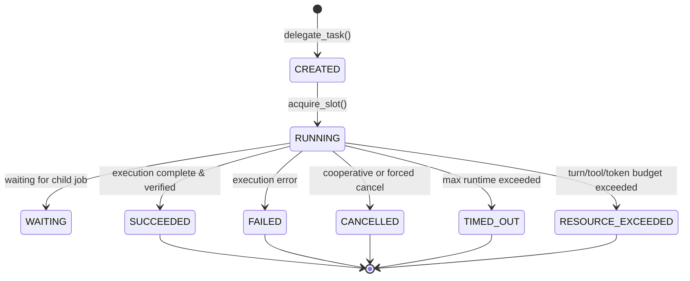

# HERMES 2.x — Subagents Architecture (SUBAGENTS_2X.md)

## 1. Architectural Philosophy
In HERMES 2.x, a subagent is **NOT another copy of the primary agent**. It does not inherit the parent agent's full transcript, accumulated tool catalog, active skills, or reasoning history.

Instead, HERMES implements a bounded, isolated parent/child delegation model based on strict separation of concerns:
$$\text{MAIN T1} \xrightarrow{\text{task.delegate (bounded envelope)}} \text{SUBAGENT (fresh context, restricted tools, isolated worktree)} \xrightarrow{\text{SubagentResult (summary, evidence, diffs)}} \text{Parent Observation} \to \text{T1 continues}$$

### Fundamental Invariant
> **Subagent SUCCESS $\neq$ Requirement VERIFIED $\neq$ Goal COMPLETE**  
> A subagent's successful completion provides evidence to the parent agent. Only the authoritative State Store and parent verification gates can transition requirements to VERIFIED and goals to COMPLETED.

---

## 2. Delegation Contract & Invariants
```
PARENT DELEGATES
CHILD ISOLATES
POLICY CONSTRAINS
WORKTREE CONTAINS
BUDGET LIMITS
JOB RUNS ASYNC
CANCELLATION STOPS
HANDOFF SUMMARIZES
EVIDENCE RETURNS
PARENT DECIDES
```

1. **Non-Recursive By Default**: Subagents cannot recursively spawn further subagents (`can_delegate=False`, default depth = 1).
2. **Ceiling Precedence**: A child subagent can never escalate permissions beyond its parent or the system ceiling.
3. **Fresh Context Isolation**: Context windows start clean without parent transcript bleed.
4. **Clean Worktree Sandboxing**: Mutating subagents execute in dedicated Git worktrees created from HEAD. The user's uncommitted changes and active branch are never touched.

---

## 3. Subagent Role Presets

| Role | Read-Only | Mutate Files | Shell Execution | Delegate | Default Allowed Tools |
| :--- | :---: | :---: | :---: | :---: | :--- |
| **EXPLORER** | Yes | No | No | No | `fs.read`, `search.glob`, `search.grep`, `tool.search`, `code.outline` |
| **REVIEWER** | Yes | No | No | No | `fs.read`, `search.glob`, `search.grep`, `git.diff` |
| **TESTER** | No | Yes (Tests) | Yes (Test runners) | No | `fs.read`, `fs.write`, `fs.edit`, `shell.bash`, `search.glob`, `search.grep` |
| **IMPLEMENTER** | No | Yes | Yes (Build/lint/test) | No | `fs.read`, `fs.write`, `fs.edit`, `shell.bash`, `search.glob`, `search.grep`, `task.todo` |
| **ANALYST** | Yes | No | No | No | `fs.read`, `search.glob`, `search.grep` |

---

## 4. Policy Engine & Privilege Ceilings
The `SubagentPolicyEngine` guarantees least-privilege execution:
- Clamps child tool requests against parent permissions.
- If parent denies `shell.bash` or `fs.write`, child cannot enable them under any circumstances.
- Denies recursive calls to `task.delegate` when `depth >= max_depth`.
- Validates tool calls prior to execution via `is_tool_allowed()`.

---

## 5. Lifecycle State Flow


All state transitions are deterministic, pure reductions in `StateReducer`, with terminal locks preventing late out-of-order event regression.
