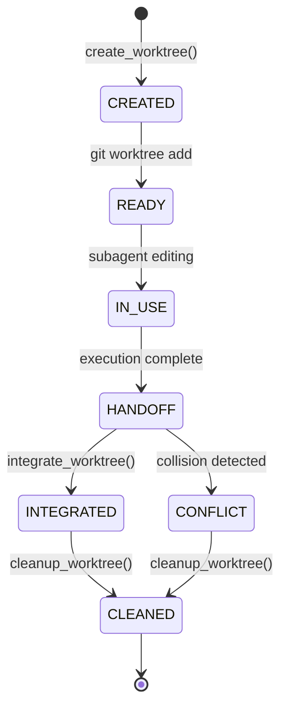

# HERMES 2.x — Git Worktree Sandboxing (WORKTREES_2X.md)

## 1. Architectural Purpose
Parallel mutating subagents operating in the same workspace risk overwriting each other's edits, generating corrupt file states, or stomping on the user's uncommitted work.

HERMES 2.x solves this by utilizing **Git worktrees** (`git worktree add`) to provide completely isolated working directories backed by the same repository.

---

## 2. Core Worktree Invariants
1. **Zero User Working Tree Mutation**:
   - `git stash` and `git checkout` are **strictly forbidden** on the user's working tree.
   - Worktrees are created directly from current `HEAD` commit onto dedicated branches (`hermes-wt-<task_id>`).
   - The user's unstaged edits and working tree remain 100% untouched.
2. **Deterministic Sandboxing**:
   - Worktree path: `<repo_root>/.hermes/worktrees/hermes-agent-<short_id>`.
   - `.hermes/` is ignored by `.gitignore`.
3. **Conflict Detection**:
   - Before integrating, HERMES inspects worktree changes (`git status --porcelain` and `git diff <base_commit>..HEAD`) and compares them against any changes made in the parent repository since `base_commit`.
   - If overlap occurs, `has_conflict=True` is flagged and the integration fails safely.
4. **Integration Policies**:
   - `PATCH_ONLY` (default): Extracts unified diff patch and file list without mutating parent workspace.
   - `FAST_FORWARD`: Fast-forwards parent branch if HEAD has not moved.
   - `MERGE_COMMIT`: Creates merge commit if cleanly mergeable.
   - `REVIEW_REQUIRED`: Holds worktree for user/T1 human-in-the-loop review.
5. **Windows Resilience**:
   - File locks are gracefully handled during cleanup via retry backoff.
6. **Orphan Recovery**:
   - `SubagentReconciler` automatically identifies abandoned worktrees on restart and safely prunes them.

---

## 3. Worktree Lifecycle

